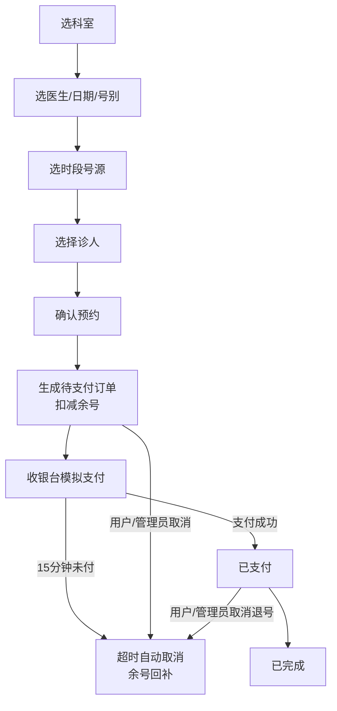

# 需求分析文档 —— 东软云医院预约挂号系统

| 项目 | 内容 |
| --- | --- |
| 名称 | 东软云医院预约挂号系统 |
| 目标 | 让患者在鸿蒙 App 完成登录、就诊人管理、查询号源、预约及订单查询；让管理员维护基础医疗资源与挂号规则。 |
| 交付形态 | Spring Boot REST 服务、Vue 管理后台、HarmonyOS App、项目文档与演示数据。 |
| 周期 | 10 天：第 1 天环境搭建；第 2–8 天开发联调；第 9–10 天测试、答辩和面试准备。 |
| 团队 | 组长（兼测试/文档）、后端、Web 前端、鸿蒙端各 1 人。 |

> 版本：v1.0（交付版） ｜ 更新日期：2026-09-05
> 配套文档：[06-系统架构设计](06-系统架构设计.md)、[02-数据设计文档](02-数据设计文档.md)、[03-接口文档](03-接口文档.md)

---

## 1. 项目背景

医院门诊挂号长期存在"排队久、跑腿多、号源不透明"的问题。本项目面向**患者**和**医院管理员**两类用户，构建一套预约挂号系统：

- 患者通过**鸿蒙手机 App** 完成注册登录、浏览科室医生、查看号源、预约挂号、模拟支付、管理就诊人，并可使用 **AI 导诊管家**进行症状咨询与科室推荐；
- 管理员通过 **Web 后台**维护科室、医生、号别、排班规则，处理挂号订单并查看运营统计。

系统采用前后端分离 + RESTful API 架构，后端为 Spring Boot 单体服务，同时服务鸿蒙端与 Web 管理端。

## 2. 用户角色与权限边界

| 角色 | 入口 | 权限边界 |
| --- | --- | --- |
| 游客 | 鸿蒙 App（未登录） | 浏览首页、科室和医生信息；可以注册、登录；进入预约、就诊人、AI 管家等功能时被引导先登录 |
| 患者（PATIENT） | 鸿蒙 App | 管理本人资料与名下就诊人；查询可预约号源；创建预约、模拟支付、取消订单（待支付/已支付均可退号）；查看本人挂号记录；使用 AI 导诊管家。**不能**访问任何 `/api/admin/**` 后台接口 |
| 系统管理员（ADMIN） | Web 管理后台 | 登录后台；维护用户、科室、医生、挂号级别、排班规则；查看全部挂号记录并取消订单；查看工作台统计看板。**不通过**患者 App 下单 |
| AI 导诊 | App 内嵌能力 | 用自然语言回答挂号与就诊流程问题、根据症状推荐科室、引导完成预约，降低使用门槛；仅作信息咨询和预约引导，**不输出医疗诊断结论、不查询实时号源**，也不能绕过患者确认直接下单或扣费 |

## 3. 核心功能清单

### 3.1 患者端（鸿蒙 App）

| 编号 | 模块 | 功能说明 |
| --- | --- | --- |
| APP-01 | 注册登录 | 手机号 + 密码注册/登录，JWT 鉴权；登录态本地持久化，Token 失效自动跳登录；退出登录 Token 加入黑名单 |
| APP-02 | 首页 | 顶部蓝色导航、Banner 轮播、搜索入口、快捷入口（预约挂号、挂号记录、就诊人、AI 管家）、热门科室 |
| APP-03 | 科室选择 | 一级/二级科室手风琴展开，支持关键字搜索，仅展示启用科室（科室树带 Redis 缓存） |
| APP-04 | 医生与号源 | 未来 7 天日期切换；按全部/普通号/专家号/主任医师号筛选；展示医生、时段、费用、余号；约满不可点 |
| APP-05 | 选择就诊人 | 展示已绑定就诊人列表，支持新增/编辑/删除（本人、父母、子女、配偶、其他）；一个账号可绑定多名就诊人 |
| APP-06 | 确认预约 | 展示医院、医生、号别、就诊时间、费用、就诊人快照信息，提交生成待支付订单 |
| APP-07 | 收银台支付 | 独立收银台页面展示订单号与金额，选择支付方式后模拟支付；支付成功跳转成功页 |
| APP-08 | 挂号记录 | 全部/待支付/已支付/已取消四个 Tab；查看订单详情；待支付订单可去支付；已支付订单可取消退号 |
| APP-09 | AI 导诊管家 | 多轮对话：症状咨询、推荐就诊科室、解答挂号与就诊流程问题、引导预约（DeepSeek 大模型，API Key 保存在后端；仅咨询引导，不自动下单） |
| APP-10 | 个人中心 | 头像昵称、挂号记录/就诊人/设置入口；设置页含清除缓存、检查更新、关于、联系客服、退出登录 |

### 3.2 管理端（Web 后台）

| 编号 | 模块 | 功能说明 |
| --- | --- | --- |
| ADM-01 | 登录与框架 | 管理员账号登录，左右布局后台，路由权限拦截 |
| ADM-02 | 工作台 | 统计用户数、科室数、医生数、今日预约数；近 7 日挂号趋势、科室挂号排行 |
| ADM-03 | 用户管理 | 患者账号分页查询、新增、编辑、停用/启用、逻辑删除 |
| ADM-04 | 科室管理 | 科室树形展示与增删改查、按名称/类型筛选、停用启用 |
| ADM-05 | 医生管理 | 医生档案维护、所属科室、职称简介、号别关联、排班关联 |
| ADM-06 | 挂号级别 | 号别编码、名称、挂号费（分）、默认限额、排序、启停 |
| ADM-07 | 排班管理 | 周期性排班规则（星期位掩码、时段、限额）维护；规则保存后自动重新展开号源 |
| ADM-08 | 挂号记录 | 订单分页查询、状态筛选、详情查看、管理员取消订单 |

### 3.3 系统级能力（对用户不可见但必须具备）

| 编号 | 能力 | 说明 |
| --- | --- | --- |
| SYS-01 | 号源自动生成 | 管理员只需维护"周一三五上午"这样的**排班规则**；系统在应用启动时和每天 00:10 自动把规则展开成未来 14 天内**每一天的具体可约时段**（即号源），患者看到的可约号源就是这样来的，无需人工逐日录入；重复执行不会生成重复号源 |
| SYS-02 | 并发防超卖 | 下单四层防护：Redis 限流（5 次/分钟）→ Redis 分布式锁（防同一就诊人重复挂号）→ 幂等键唯一约束（防重试重复下单）→ 号源乐观锁条件更新（防超卖的数据库兜底） |
| SYS-03 | 超时自动取消 | 待支付订单 15 分钟未支付，定时任务每分钟扫描自动取消并释放号源 |
| SYS-04 | 缓存 | 科室树、号源查询等热点数据使用 Redis Cache-Aside 缓存，数据变更时主动失效 |
| SYS-05 | 大 ID 精度保护 | 雪花算法 ID 超过 JS 安全整数范围，后端统一序列化为字符串返回，前端全链路按字符串传递 |

## 4. 业务流程（挂号主流程）

## 5. 非功能性需求

| 类别 | 要求 |
| --- | --- |
| 一致性 | 同一时刻多人抢同一最后号源不得超卖；重复点击/网络重试不得生成重复订单 |
| 安全性 | 密码 BCrypt 加密存储；接口 JWT 鉴权；AI Key 只存后端；身份证字段预留 AES-GCM 加密位 |
| 可维护性 | 统一响应体 `ApiResponse<T>`、全局异常处理、统一错误码；前端设计令牌集中管理，禁止硬编码色值/字号 |
| 可移植性 | 主键使用雪花算法，为以后分库分表留余地 |
| 兼容性 | 移动端 HarmonyOS（ArkTS/ArkUI）；管理端 Chrome/Edge 现代浏览器 |

> 本需求文档为项目立项基线，描述目标系统的范围与边界；具体哪些功能在本期已完成、哪些暂未实现，见 [08-项目总结](08-项目总结.md)。
