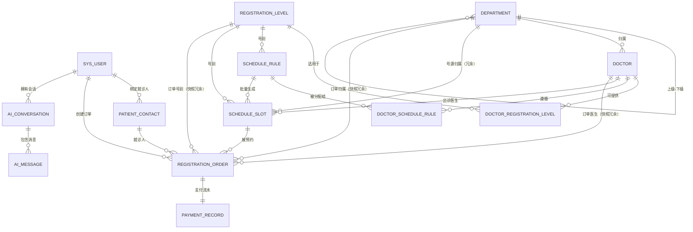

# 数据设计文档

> 版本：v1.0（交付版） ｜ 更新日期：2026-09-05
>
> 建表脚本：`Hos_App/his-springboot/src/main/resources/db/01_schema.sql`
>
> 演示数据：`Hos_App/his-springboot/src/main/resources/db/02_demo_seed.sql`

## 0. 设计结论

数据库名称 `neusoft_cloud_hospital`，MySQL 8.0+（开发固定 8.0.36），字符集 `utf8mb4`。执行 `01_schema.sql` 建库建表后，可执行 `02_demo_seed.sql` 导入演示资料：管理员 `admin / admin123`、患者账号（手机号 `13800000002`\~`13800000007`，密码均为 `password`）、28 个科室、11 位医生、5 种号别、18 条排班规则及 94 条种子号源；应用启动后号源生成器会自动把号源滚动补充到未来 14 天。

**分层模型**：基础资料（科室/医生/号别）→ 排班规则（周期模板）→ 号源（每日可约时段）→ 挂号订单。排班规则本身不可直接预约，患者只能对号源 `schedule_slot` 下单，余号、停诊、并发控制都落在号源表上。

| 维度       | 取值                                                        |
| -------- | --------------------------------------------------------- |
| 数据库类型    | MySQL 8.0.36 Community Server                             |
| 字符集 / 排序 | utf8mb4 / utf8mb4\_0900\_ai\_ci                           |
| 存储引擎     | InnoDB（事务、行锁、CHECK 约束）                                    |
| 主键生成     | 应用层雪花算法 `BIGINT UNSIGNED`，不用自增，便于未来分库分表                   |
| 金额存储     | 整数"分"（`500` = ¥5.00），前端只负责格式化展示                           |
| 逻辑删除     | 需保留历史的表带 `deleted TINYINT DEFAULT 0`，删除只置 1               |
| 审计字段     | 统一 `created_at` / `updated_at`，MySQL 默认值 + ON UPDATE 自动维护 |
| 物理外键     | **不建物理外键**（降低逻辑删除/批量导入/号源生成的耦合），关联完整性由 Service 层 + 索引保证   |
| 大 ID 传输  | 雪花 ID 超过 JS 安全整数（2^53），接口统一序列化为**字符串**返回，前端全链路按字符串传递      |
| 敏感字段     | 就诊人身份证预留 AES-GCM 密文 + SHA-256 哈希列；AI 密钥仅存环境变量不落库          |

***

## 1. ER 关系图

> 关系基数：`||--o{` 一对多、`||--||` 一对一。真实数据库无物理外键，下图为按业务逻辑画出的设计级关系。



**多对多中间表**：`doctor_registration_level`（医生 ↔ 号别）、`doctor_schedule_rule`（医生 ↔ 排班规则，规则可复用）。
**快照冗余**：`registration_order` 在下单时刻冗余医生姓名、科室名、号别名、就诊时间，基础资料后续变更不影响历史订单展示。

***

## 2. 表清单总览（13 张）

| 序号 | 表名                          | 中文名     | 核心字段                                                                      | 说明                          |
| -- | --------------------------- | ------- | ------------------------------------------------------------------------- | --------------------------- |
| 1  | `sys_user`                  | 系统用户    | `phone`、`username`、`user_type`、`status`                                   | 患者与管理员共用一张表，用 user\_type 区分 |
| 2  | `patient_contact`           | 就诊人     | `user_id`、`name`、`phone`、`relation`                                       | 一个账号可绑定多个（本人/父母/子女/配偶/其他）   |
| 3  | `department`                | 科室      | `code`、`name`、`parent_id`、`enabled`                                       | 两级树，parent\_id=0 为一级科室      |
| 4  | `registration_level`        | 挂号级别    | `code`、`name`、`fee_fen`、`default_quota`                                   | 号别：普通号/专家号/主任医师号，决定费用       |
| 5  | `doctor`                    | 医生档案    | `name`、`department_id`、`title`、`introduction`                             | 医生基本信息                      |
| 6  | `doctor_registration_level` | 医生-号别关联 | `doctor_id`、`level_id`                                                    | 多对多：一名医生可出多种号别              |
| 7  | `schedule_rule`             | 排班规则    | `level_id`、`weekday_mask`、`period`、`slots_json`                           | 周期模板（如周一三五上午），可复用           |
| 8  | `doctor_schedule_rule`      | 医生-规则关联 | `doctor_id`、`schedule_rule_id`                                            | 多对多：多名医生可复用同一条规则            |
| 9  | `schedule_slot`             | 号源      | `doctor_id`、`visit_date`、`start_time`、`remaining_quota`、`version`         | 患者真正可约的时段，唯一扣号依据            |
| 10 | `registration_order`        | 挂号订单    | `order_no`、`contact_id`、`slot_id`、`amount_fen`、`status`、`idempotency_key` | 含医生/科室/号别快照，四状态流转           |
| 11 | `payment_record`            | 支付流水    | `order_id`、`channel`、`trade_no`、`status`                                  | 与订单一对一，本期 MOCK 模拟支付         |
| 12 | `ai_conversation`           | AI 会话（预留）   | `user_id`、`title`、`last_message_at`                                       | 当前版本 AI 多轮对话由客户端携带消息列表、服务端无状态；本表预留用于会话持久化 |
| 13 | `ai_message`                | AI 消息（预留）   | `conversation_id`、`role`、`content`                                        | 同上，随 ai_conversation 预留      |

***

## 3. 每张表字段详细设计

格式：**字段** / **类型** / **是否为空**（NO=非空）/ **注释**（取自 MySQL COMMENT）；约束单列每张表末尾。

### 3.1 sys\_user — 系统用户（患者 & 管理员）

| 字段                          | 类型              | 可空  | 注释                                |
| --------------------------- | --------------- | --- | --------------------------------- |
| `id`                        | bigint unsigned | NO  | 雪花主键，应用层生成                        |
| `username`                  | varchar(32)     | YES | 管理员登录账号；患者为空，唯一                   |
| `phone`                     | varchar(20)     | NO  | 患者登录手机号，唯一                        |
| `password_hash`             | varchar(100)    | NO  | BCrypt 加密密文，不存明文                  |
| `nickname`                  | varchar(50)     | NO  | 展示昵称，默认"用户"                       |
| `avatar_url`                | varchar(500)    | YES | 头像 URL                            |
| `user_type`                 | varchar(16)     | NO  | ADMIN 管理员 / PATIENT 患者，默认 PATIENT |
| `status`                    | tinyint         | NO  | 1 启用 / 0 停用（停用不能登录，数据保留）          |
| `last_login_at`             | datetime        | YES | 最近登录时间                            |
| `deleted`                   | tinyint         | NO  | 逻辑删除标记                            |
| `created_at` / `updated_at` | datetime        | NO  | 创建 / 更新时间                         |

**约束**：`PRIMARY KEY (id)`；`UNIQUE uk_user_username (username)`；`UNIQUE uk_user_phone (phone)`；`KEY idx_user_status_created (status, created_at)`。

### 3.2 patient\_contact — 就诊人

| 字段                          | 类型              | 可空  | 注释                                                    |
| --------------------------- | --------------- | --- | ----------------------------------------------------- |
| `id`                        | bigint unsigned | NO  | 雪花主键                                                  |
| `user_id`                   | bigint unsigned | NO  | 所属登录账号（sys\_user.id）                                  |
| `name`                      | varchar(50)     | NO  | 就诊人姓名                                                 |
| `id_card_cipher`            | varbinary(512)  | YES | 身份证 AES-GCM 密文，严禁明文回显；接口仅返回脱敏值（前 3 后 4）                       |
| `id_card_hash`              | char(64)        | YES | 身份证 SHA-256 哈希，用于同账号下判重                                   |
| `phone`                     | varchar(20)     | NO  | 就诊人手机号                                                |
| `relation`                  | varchar(20)     | NO  | SELF 本人 / PARENT 父母 / CHILD 子女 / SPOUSE 配偶 / OTHER 其他 |
| `deleted`                   | tinyint         | NO  | 逻辑删除                                                  |
| `created_at` / `updated_at` | datetime        | NO  | 创建 / 更新时间                                             |

**约束**：`PRIMARY KEY (id)`；`UNIQUE uk_contact_user_idcard (user_id, id_card_hash)`；`KEY idx_contact_user_deleted (user_id, deleted)`。

### 3.3 department — 科室（两级树）

| 字段                          | 类型              | 可空  | 注释                                              |
| --------------------------- | --------------- | --- | ----------------------------------------------- |
| `id`                        | bigint unsigned | NO  | 雪花主键                                            |
| `code`                      | varchar(32)     | NO  | 科室编码，全局唯一                                       |
| `name`                      | varchar(100)    | NO  | 科室名称                                            |
| `parent_id`                 | bigint unsigned | NO  | 上级科室 ID，**0 = 一级科室**                            |
| `department_type`           | varchar(20)     | NO  | CLINICAL 临床 / MEDICAL\_TECHNOLOGY 医技 / OTHER 其他 |
| `description`               | varchar(500)    | YES | 科室简介                                            |
| `sort_no`                   | int             | NO  | 同级排序，越小越靠前，默认 0                                 |
| `enabled`                   | tinyint         | NO  | 1 启用 / 0 停用（停用后患者端不展示）                          |
| `deleted`                   | tinyint         | NO  | 逻辑删除                                            |
| `created_at` / `updated_at` | datetime        | NO  | 创建 / 更新时间                                       |

**约束**：`PRIMARY KEY (id)`；`UNIQUE uk_department_code (code)`；`KEY idx_department_parent_enabled_sort (parent_id, enabled, sort_no)`。

> 系统约定二级科室 parent\_id 指向一级科室，暂不支持三级。

### 3.4 registration\_level — 挂号级别（号别）

| 字段                          | 类型              | 可空 | 注释                  |
| --------------------------- | --------------- | -- | ------------------- |
| `id`                        | bigint unsigned | NO | 雪花主键                |
| `code`                      | varchar(32)     | NO | 号别编码，全局唯一           |
| `name`                      | varchar(50)     | NO | 号别名称（普通号/专家号/主任医师号） |
| `fee_fen`                   | int unsigned    | NO | 挂号费（分），500 = ¥5.00  |
| `default_quota`             | int unsigned    | NO | 默认每时段限号数，仅供建规则时参考   |
| `sort_no`                   | int             | NO | 排序权重                |
| `enabled` / `deleted`       | tinyint         | NO | 启停 / 逻辑删除           |
| `created_at` / `updated_at` | datetime        | NO | 创建 / 更新时间           |

**约束**：`PRIMARY KEY (id)`；`UNIQUE uk_level_code (code)`；`KEY idx_level_enabled_sort (enabled, sort_no)`。

### 3.5 doctor — 医生档案

| 字段                          | 类型              | 可空  | 注释                  |
| --------------------------- | --------------- | --- | ------------------- |
| `id`                        | bigint unsigned | NO  | 雪花主键                |
| `name`                      | varchar(50)     | NO  | 医生姓名                |
| `department_id`             | bigint unsigned | NO  | 所属科室（department.id） |
| `title`                     | varchar(50)     | YES | 职称：主任医师/副主任医师/主治医师… |
| `introduction`              | text            | YES | 医生简介，患者端预约页展示       |
| `enabled` / `deleted`       | tinyint         | NO  | 启停 / 逻辑删除           |
| `created_at` / `updated_at` | datetime        | NO  | 创建 / 更新时间           |

**约束**：`PRIMARY KEY (id)`；`KEY idx_doctor_department_enabled (department_id, enabled)`。

> 医生能挂哪些号别、用哪些排班规则，由 3.6 / 3.8 两张关联表决定，不在本表加字段。

### 3.6 doctor\_registration\_level — 医生 ↔ 号别关联

| 字段                          | 类型              | 可空 | 注释                         |
| --------------------------- | --------------- | -- | -------------------------- |
| `id`                        | bigint unsigned | NO | 雪花主键                       |
| `doctor_id`                 | bigint unsigned | NO | 医生（doctor.id）              |
| `level_id`                  | bigint unsigned | NO | 号别（registration\_level.id） |
| `enabled`                   | tinyint         | NO | 是否启用                       |
| `created_at` / `updated_at` | datetime        | NO | 创建 / 更新时间                  |

**约束**：`PRIMARY KEY (id)`；`UNIQUE uk_doctor_level (doctor_id, level_id)`；`KEY idx_drl_level_enabled (level_id, enabled)`。

### 3.7 schedule\_rule — 周期性排班规则

| 字段                          | 类型               | 可空  | 注释                                                     |
| --------------------------- | ---------------- | --- | ------------------------------------------------------ |
| `id`                        | bigint unsigned  | NO  | 雪花主键                                                   |
| `level_id`                  | bigint unsigned  | NO  | 规则对应号别                                                 |
| `rule_name`                 | varchar(100)     | NO  | 说明文字，如"周一三五上午专家号"                                      |
| `weekday_mask`              | tinyint unsigned | NO  | 位掩码：bit0\~bit6 = 周一\~周日，周一三五 = 21                      |
| `period`                    | varchar(16)      | NO  | MORNING 上午 / AFTERNOON 下午 / EVENING 晚上 / FULL 全天       |
| `slots_json`                | json             | NO  | 时段与限额，如 `[{"start":"08:00","end":"08:30","quota":10}]` |
| `effective_start`           | date             | NO  | 生效开始日期                                                 |
| `effective_end`             | date             | YES | 生效结束日期，NULL = 长期有效                                     |
| `enabled` / `deleted`       | tinyint          | NO  | 启停 / 逻辑删除                                              |
| `created_at` / `updated_at` | datetime         | NO  | 创建 / 更新时间                                              |

**约束**：`PRIMARY KEY (id)`；`KEY idx_rule_level_enabled (level_id, enabled)`；`KEY idx_rule_effective_range (effective_start, effective_end)`。

### 3.8 doctor\_schedule\_rule — 医生 ↔ 排班规则关联

> 规则复用的核心中间表：一条规则可分配给多位医生，避免重复配置。

| 字段                 | 类型              | 可空 | 注释   |
| ------------------ | --------------- | -- | ---- |
| `id`               | bigint unsigned | NO | 雪花主键 |
| `doctor_id`        | bigint unsigned | NO | 医生   |
| `schedule_rule_id` | bigint unsigned | NO | 排班规则 |
| `created_at`       | datetime        | NO | 创建时间 |

**约束**：`PRIMARY KEY (id)`；`UNIQUE uk_doctor_rule (doctor_id, schedule_rule_id)`；`KEY idx_dsr_rule (schedule_rule_id)`。

### 3.9 schedule\_slot — 号源（实际可预约时段 / 库存）

> **唯一扣号依据**。号源生成器在应用启动时与每天 00:10，把启用规则按"医生 × 规则"展开为未来 14 天的号源；靠唯一键幂等，不重复生成。

| 字段                          | 类型              | 可空  | 注释                                 |
| --------------------------- | --------------- | --- | ---------------------------------- |
| `id`                        | bigint unsigned | NO  | 雪花主键                               |
| `schedule_rule_id`          | bigint unsigned | YES | 来源规则；管理员临时加号为 NULL                 |
| `doctor_id`                 | bigint unsigned | NO  | 出诊医生                               |
| `department_id`             | bigint unsigned | NO  | 科室（冗余，便于按科室查询）                     |
| `level_id`                  | bigint unsigned | NO  | 号别                                 |
| `visit_date`                | date            | NO  | 就诊日期                               |
| `start_time` / `end_time`   | time            | NO  | 时段开始 / 结束                          |
| `total_quota`               | int unsigned    | NO  | 该时段放号总数                            |
| `remaining_quota`           | int unsigned    | NO  | 剩余可约数；下单 -1，取消/超时 +1               |
| `status`                    | varchar(16)     | NO  | OPEN 可约 / CLOSED 停诊 / CANCELLED 取消 |
| `version`                   | int unsigned    | NO  | **乐观锁版本号**，并发抢号防超卖                 |
| `created_at` / `updated_at` | datetime        | NO  | 创建 / 更新时间                          |

**约束**：`PRIMARY KEY (id)`；`UNIQUE uk_slot_doctor_date_time_level (doctor_id, visit_date, start_time, end_time, level_id)`；`KEY idx_slot_department_date_level (department_id, visit_date, level_id, status)`；`KEY idx_slot_doctor_date (doctor_id, visit_date, status)`；`CHECK (remaining_quota <= total_quota)`。

**抢号条件 SQL（核心并发点）**：

```sql
UPDATE schedule_slot
SET remaining_quota = remaining_quota - 1,
    version = version + 1
WHERE id = ? AND status = 'OPEN'
  AND remaining_quota > 0 AND version = ?;
-- 影响行数 = 0 → 该时段已约满或状态已变化
```

### 3.10 registration\_order — 挂号预约订单

| 字段                                         | 类型              | 可空  | 注释                                                              |
| ------------------------------------------ | --------------- | --- | --------------------------------------------------------------- |
| `id`                                       | bigint unsigned | NO  | 雪花主键                                                            |
| `order_no`                                 | varchar(32)     | NO  | 订单编号（展示用），唯一                                                    |
| `user_id`                                  | bigint unsigned | NO  | 下单账号                                                            |
| `contact_id`                               | bigint unsigned | NO  | 就诊人                                                             |
| `slot_id`                                  | bigint unsigned | NO  | 预约号源                                                            |
| `doctor_id` / `department_id` / `level_id` | bigint unsigned | NO  | 医生/科室/号别（冗余快照维度）                                                |
| `doctor_name_snapshot`                     | varchar(50)     | NO  | 下单时刻医生姓名                                                        |
| `department_name_snapshot`                 | varchar(100)    | NO  | 下单时刻科室名                                                         |
| `level_name_snapshot`                      | varchar(50)     | NO  | 下单时刻号别名                                                         |
| `visit_date`                               | date            | NO  | 就诊日期（快照）                                                        |
| `start_time` / `end_time`                  | time            | NO  | 就诊时段（快照）                                                        |
| `amount_fen`                               | int unsigned    | NO  | 订单金额（分）                                                         |
| `status`                                   | varchar(24)     | NO  | PENDING\_PAYMENT 待支付 / PAID 已支付 / COMPLETED 已完成 / CANCELLED 已取消 |
| `expired_at`                               | datetime        | NO  | 支付截止时间（下单 +15 分钟），超时自动取消                                        |
| `paid_at`                                  | datetime        | YES | 支付时间                                                            |
| `cancelled_at`                             | datetime        | YES | 取消时间                                                            |
| `cancel_reason`                            | varchar(255)    | YES | 取消来源：USER 用户 / ADMIN 管理员 / TIMEOUT 超时                           |
| `idempotency_key`                          | varchar(64)     | YES | 客户端幂等键（UUID），防重试重复下单                                            |
| `created_at` / `updated_at`                | datetime        | NO  | 创建 / 更新时间                                                       |

**约束**：`PRIMARY KEY (id)`；`UNIQUE uk_order_no (order_no)`；`UNIQUE uk_order_user_idempotency (user_id, idempotency_key)`；`KEY idx_order_user_status_created (user_id, status, created_at)`；`KEY idx_order_slot_status (slot_id, status)`；`KEY idx_order_expire_status (expired_at, status)`（超时扫描）；`KEY idx_order_contact_date (contact_id, visit_date)`。

**状态机**：

```
PENDING_PAYMENT ──支付成功──► PAID ──就诊完成──► COMPLETED
       │                        │
       ├──超时/用户/管理员────────┴──用户/管理员退号──► CANCELLED
```

> 待支付与已支付订单均可取消（已支付取消=退号），取消后号源余号回补。

### 3.11 payment\_record — 支付流水

| 字段                          | 类型              | 可空  | 注释                                             |
| --------------------------- | --------------- | --- | ---------------------------------------------- |
| `id`                        | bigint unsigned | NO  | 雪花主键                                           |
| `order_id`                  | bigint unsigned | NO  | 对应订单（1:1）                                      |
| `channel`                   | varchar(20)     | NO  | 支付渠道，本期固定 MOCK 模拟支付，预留微信/支付宝                   |
| `trade_no`                  | varchar(64)     | YES | 第三方交易号（模拟支付为应用生成的假号）                           |
| `amount_fen`                | int unsigned    | NO  | 支付金额（分）                                        |
| `status`                    | varchar(16)     | NO  | INIT 待支付 / SUCCESS 成功 / FAILED 失败 / CLOSED 已关闭 |
| `paid_at`                   | datetime        | YES | 支付成功时间                                         |
| `created_at` / `updated_at` | datetime        | NO  | 创建 / 更新时间                                      |

**约束**：`PRIMARY KEY (id)`；`UNIQUE uk_payment_order (order_id)`；`UNIQUE uk_payment_trade_no (trade_no)`。

### 3.12 ai\_conversation — AI 对话会话

| 字段                          | 类型              | 可空  | 注释             |
| --------------------------- | --------------- | --- | -------------- |
| `id`                        | bigint unsigned | NO  | 雪花主键           |
| `user_id`                   | bigint unsigned | NO  | 所属用户           |
| `title`                     | varchar(100)    | NO  | 会话标题，默认"新对话"   |
| `last_message_at`           | datetime        | YES | 最后一条消息时间（列表排序） |
| `deleted`                   | tinyint         | NO  | 逻辑删除           |
| `created_at` / `updated_at` | datetime        | NO  | 创建 / 更新时间      |

**约束**：`PRIMARY KEY (id)`；`KEY idx_conversation_user_last (user_id, deleted, last_message_at)`。

### 3.13 ai_message — AI 对话消息（当前版本预留，代码未使用）

| 字段                | 类型              | 可空 | 注释                                                  |
| ----------------- | --------------- | -- | --------------------------------------------------- |
| `id`              | bigint unsigned | NO | 雪花主键                                                |
| `conversation_id` | bigint unsigned | NO | 所属会话                                                |
| `role`            | varchar(16)     | NO | USER 用户 / ASSISTANT AI / SYSTEM 系统提示词 / TOOL 工具调用记录 |
| `content`         | text            | NO | 消息文本                                                |
| `created_at`      | datetime        | NO | 消息时间                                                |

**约束**：`PRIMARY KEY (id)`；`KEY idx_message_conversation_created (conversation_id, created_at)`。

***

## 4. 关键设计决策与实施注意

1. **规则与号源分离**：排班规则是周期模板，患者只能对号源下单；扣库存只动 `schedule_slot`，规则表永不因预约改变。
2. **号源自动生成**：启动时 + 每天 00:10 把启用规则展开为未来 14 天号源，`uk_slot_doctor_date_time_level` 唯一键保证幂等；生成后失效号源查询缓存。
3. **订单快照**：医生姓名/科室名/号别名/金额/时间全部冗余进订单，历史数据不受基础资料变更影响。
4. **防超卖三层防护**：Redis 分布式锁（请求串行化）→ 号源 `version` 乐观锁条件更新（数据库兜底）→ 幂等键唯一约束（重试/重复点击兜底）；禁止"先查余号再更新"的竞态写法。
5. **无物理外键**：关联完整性由 Service 层校验 + 唯一/普通索引保证，降低逻辑删除与批量导入耦合。
6. **金额全链路分单位**：数据库、Java、JSON 一律整数分，前端只做"分→元"展示。
7. **大 ID 字符串传输**：雪花 ID 序列化为字符串返回，前端禁止 `Number()` 转换，否则超过 2^53 会精度丢失（实际踩过的坑：下单传错就诊人 ID 导致"就诊人不存在"）。
8. **JSON 字段边界**：`slots_json` 只存不参与查询过滤的时段配置；若未来需按时段统计，建议拆出独立时段表。
9. **超时取消**：定时任务每分钟扫描 `expired_at` 过期的待支付订单，取消并回补号源（`remaining_quota +1`、`version +1`）。

