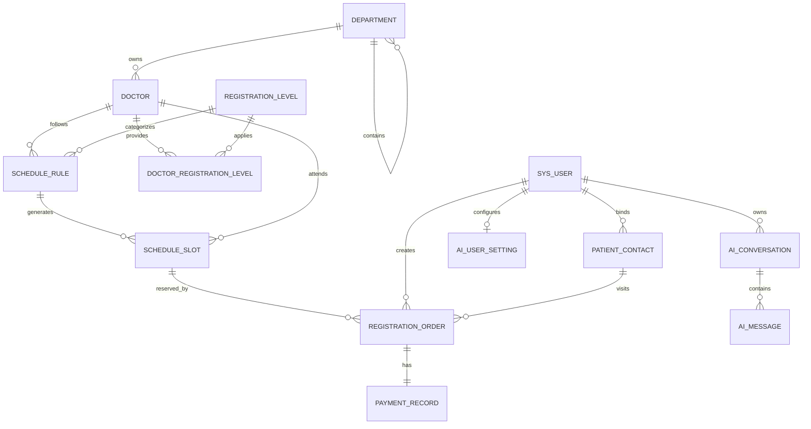

# 数据库设计说明

## 1. 设计结论

数据库名称为 `neusoft_cloud_hospital`，目标版本 MySQL 8.0+，字符集使用 `utf8mb4`。可直接使用 [`database/01_schema.sql`](../database/01_schema.sql) 初始化。

开发环境可在建表后执行 [`database/02_demo_seed.sql`](../database/02_demo_seed.sql) 导入演示资料。它含预置管理员 `admin/admin123`、4 个虚构患者账号（手机号 `13800000002` 至 `13800000005`，密码均为 `password`）、13 个科室、10 位医生、3 种号别、10 条排班规则及按导入日期生成的未来 7 天号源；账号只限本地开发。

本设计采用“基础资料 → 排班规则 → 预约时段 → 订单”的分层模型。排班规则不可直接作为预约依据；系统任务将规则预生成未来 7 日的 `schedule_slot`，患者只能对实际时段下单。这让余号、停诊、临时加号和并发控制都有稳定的落点。

## 2. ER 关系



## 3. 实体职责

| 分组 | 表 | 职责 |
| --- | --- | --- |
| 账号 | `sys_user`、`patient_contact` | 账户、管理员/患者身份及多就诊人。身份证存加密密文和判重哈希。 |
| 基础资料 | `department`、`doctor`、`registration_level`、`doctor_registration_level` | 科室树、医生和号别；关联表避免把一位医生限制为单一号别。 |
| 排班预约 | `schedule_rule`、`schedule_slot`、`registration_order`、`payment_record` | 规则配置、实际库存、业务订单和支付流水。订单保留医生/科室/号别/金额/时间快照。 |
| 扩展运维 | `sys_banner`、`ai_user_setting`、`ai_conversation`、`ai_message`、`operation_log` | 首页内容、AI 配置与会话、管理员操作审计。 |

## 4. 字段与约束约定

- 业务主键使用应用层生成的 `BIGINT UNSIGNED`（推荐 Snowflake 或号段），不使用自增，方便后续服务拆分。
- 所有金额字段使用整数分，如 `500` 表示 ¥5.00；前端只负责展示格式化。
- 所有需要保留历史的基础资料含 `deleted` 逻辑删除标识。查询必须默认追加 `deleted=0`。
- `username` 仅供管理员以账号密码登录，患者保持 `NULL` 并以手机号登录；`username` 和 `phone` 均有唯一约束。逻辑删除账户不允许重新注册相同手机号，避免身份与历史订单歧义；如需恢复由管理员启用原账户。
- `patient_contact` 使用 `(user_id, id_card_hash)` 唯一约束，杜绝同账户重复绑定同一身份证；身份证密文使用应用密钥 AES-GCM 加密。
- `schedule_slot` 的唯一键限定“同医生、日期、起止时间、号别”只生成一条库存记录。
- `registration_order` 的 `(user_id, idempotency_key)` 唯一键用于拦截网络重试造成的重复下单；客户端每次确认操作生成 UUID 并复用至响应返回。

## 5. 预约事务与库存规则

创建预约时，后端在一个本地事务中依次完成：校验 JWT 与就诊人归属 → 校验日期、时段和医生有效性 → 校验同就诊人是否已有冲突的有效预约 → 使用条件 SQL 扣减库存 → 写入 `PENDING_PAYMENT` 订单和支付初始化记录 → 投递 15 分钟超时事件。

库存扣减必须由数据库条件更新完成，而不是先查后写：

```sql
UPDATE schedule_slot
SET remaining_quota = remaining_quota - 1,
    version = version + 1
WHERE id = :slotId
  AND status = 'OPEN'
  AND remaining_quota > 0
  AND version = :version;
```

影响行数为 0 时，统一返回“该时段已约满或状态已变化”。取消或超时任务也必须以订单当前状态为条件更新；只有从 `PENDING_PAYMENT` 成功切换到 `CANCELLED` 的请求，才能执行一次 `remaining_quota + 1`。支付成功则仅允许 `PENDING_PAYMENT → PAID`。

## 6. 排班生成规则

`schedule_rule.weekday_mask` 的 bit0 至 bit6 对应周一至周日，例如周一、周三、周五为二进制 `0010101`，十进制为 `21`。`slots_json` 保存某一午别的具体时间段与每段限额。每日定时任务扫描有效规则并补齐未来第 7 天的 `schedule_slot`；生成应使用唯一键或 upsert，保证任务重跑不产生重复时段。

管理员停用医生、号别或规则时：未来未支付时段可关闭；已支付订单仍读取订单快照并保留。禁止直接删除被订单或时段引用的基础资料，应使用 `enabled=0` 停用。

## 7. 实施注意事项

1. SQL 中的 `CHECK` 依赖 MySQL 8.0.16+；项目要求 MySQL 8，建议使用 8.0.30+。服务层仍需校验配额与状态。
2. 初版不建立数据库外键，以降低逻辑删除、批量初始化和排班生成的耦合；所有关联完整性由服务层校验，索引已为主要查询场景准备。
3. `JSON` 仅用于变化频繁的排班时段和审计细节，不用于核心筛选字段。若后续需要按规则时段统计，可拆出 `schedule_rule_slot` 表。
4. `ai_user_setting.api_key_cipher` 和就诊人身份证严禁回显、导出或写入日志；应用加密密钥仅从部署环境变量读取。
5. 演示脚本不插入就诊人和订单：身份证采用应用层 AES-GCM 加密，不能在纯 SQL 中安全、可移植地生成密文。联调时应通过“新增就诊人”和“创建订单”接口构造数据，这同时验证了加密、鉴权、库存扣减和状态机。
