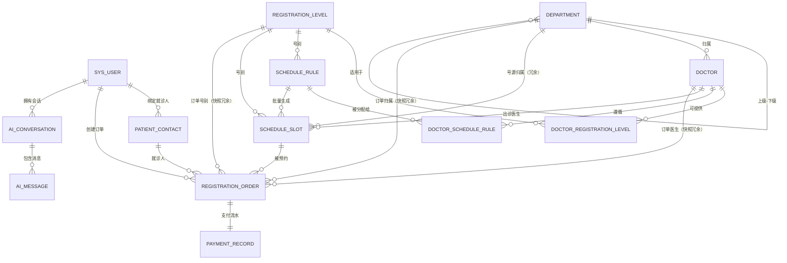

# 数据库设计说明

## 0. 设计结论

数据库名称为 `neusoft_cloud_hospital`，目标版本 MySQL 8.0+（项目固定使用 **8.0.36**），字符集 `utf8mb4`。可直接使用 [`database/01_schema.sql`](../database/01_schema.sql) 初始化。

开发环境建表后可执行 [`database/02_demo_seed.sql`](../database/02_demo_seed.sql) 导入演示资料：预置管理员 `admin / admin123`、患者账号（手机号 `13800000002` ~ `13800000007`，密码均为 `password`）、28 个科室、11 位医生、5 种号别、18 条排班规则及未来 7 天共 94 条号源。

**分层模型**：基础资料 → 排班规则 → 预约时段 → 挂号订单。排班规则本身不可直接作为预约依据；每日任务预生成未来 7 天的 `schedule_slot`，患者只能对"实际时段"下单，余号、停诊、临时加号、并发控制都有稳定落点。

| 维度 | 取值 |
| --- | --- |
| 数据库类型 | MySQL 8.0.36 Community Server |
| 字符集 / 排序 | utf8mb4 / utf8mb4_0900_ai_ci |
| 存储引擎 | InnoDB（支持事务、外键校验、全文索引） |
| 主键生成 | 应用层雪花算法（`BIGINT UNSIGNED`），不使用自增，方便服务拆分 |
| 金额存储 | 整数"分"（`500` = ¥5.00），前端只负责展示格式化 |
| 软删除 | 所有需保留历史的基础资料带 `deleted tinyint NOT NULL DEFAULT 0` |
| 审计字段 | 统一为 `created_at datetime NOT NULL DEFAULT CURRENT_TIMESTAMP` + `updated_at datetime ... ON UPDATE CURRENT_TIMESTAMP` |
| 外键约束 | 本期**不建立物理外键**（降低逻辑删除 / 批量初始化 / 排班生成的耦合），由服务层校验关联完整性，关键关联字段均已建索引 |
| 敏感字段 | `patient_contact` 的身份证号密文 + SHA-256 判重哈希、AI 接入密钥仅存部署环境变量不落库 |

---

## 1. Mermaid ER 关系图

> 关系基数说明：`||--o{` 一对多（1 : 0…N）、`||--||` 一对一、`}o--o{` 多对多。真实数据库**无物理外键**，下图是按业务逻辑画出的"设计级"关系。



**多对多中间表**：
- `doctor_registration_level` 连接医生 ↔ 号别（一位医生可挂多个号别，一个号别可被多位医生使用）
- `doctor_schedule_rule` 连接医生 ↔ 排班规则（一条规则可分配给多位医生复用，减少规则表重复）

**冗余快照字段**：`registration_order` 在下单时刻冗余保存 `doctor_name_snapshot / department_name_snapshot / level_name_snapshot / visit_date / start_time / end_time`，这是典型的"订单快照射"设计——医生改名字或科室改名不影响已下单订单的历史展示。

---

## 2. 表清单总览（13 张）

| 编号 | 表名 | 中文名 | 所属领域 |
| --- | --- | --- | --- |
| 1 | `sys_user` | 系统用户（患者 & 管理员） | 用户身份 |
| 2 | `department` | 科室（两级树） | 基础资料 |
| 3 | `registration_level` | 挂号级别（普通号/专家号…） | 基础资料 |
| 4 | `doctor` | 医生档案 | 基础资料 |
| 5 | `doctor_registration_level` | 医生可提供的挂号级别 | 基础资料（中间表） |
| 6 | `schedule_rule` | 周期性排班规则 | 排班 |
| 7 | `doctor_schedule_rule` | 医生 ↔ 排班规则 分配 | 排班（中间表） |
| 8 | `schedule_slot` | 实际可预约时段 / 库存 | 排班 & 号源 |
| 9 | `patient_contact` | 就诊人 | 患者 |
| 10 | `registration_order` | 挂号预约订单 | 订单 |
| 11 | `payment_record` | 支付流水 | 订单 |
| 12 | `ai_conversation` | AI 会话 | AI 管家 |
| 13 | `ai_message` | AI 对话消息 | AI 管家 |

---

## 3. 每张表字段详细设计

格式说明：**字段** / **类型** / **长度** / **是否为空**（NO = 非空 / YES = 允许空）/ **注释**（取自 MySQL `COMMENT`）。约束（主键 / 唯一键 / 外键 / 检查）单独列在每张表末尾。

---

### 3.1 sys_user — 系统用户（患者 & 管理员）

| 字段 | 类型 | 长度 | 是否为空 | 注释 |
| --- | --- | --- | --- | --- |
| `id` | bigint unsigned | 20 | **NO** | 雪花主键，应用层生成 |
| `username` | varchar | 32 | YES | 管理员登录账号；患者不使用，此字段为空 |
| `phone` | varchar | 20 | **NO** | 患者登录用的手机号（唯一） |
| `password_hash` | varchar | 100 | **NO** | BCrypt 加密密文，不存明文 |
| `nickname` | varchar | 50 | **NO** | 展示昵称，默认"用户" |
| `avatar_url` | varchar | 500 | YES | 用户头像 URL |
| `user_type` | varchar | 16 | **NO** | 账号类型：ADMIN 管理员 / PATIENT 患者，默认 PATIENT |
| `status` | tinyint | 4 | **NO** | 账号状态：1 启用 / 0 停用（停用后不能登录但数据保留） |
| `last_login_at` | datetime | — | YES | 最后登录时间 |
| `deleted` | tinyint | 4 | **NO** | 逻辑删除标记 |
| `created_at` | datetime | — | **NO** | 创建时间，默认 CURRENT_TIMESTAMP |
| `updated_at` | datetime | — | **NO** | 更新时间，默认 CURRENT_TIMESTAMP ON UPDATE |

**约束**：`PRIMARY KEY (id)`；`UNIQUE KEY uk_user_phone (phone)`；`UNIQUE KEY uk_user_username (username)`；`KEY idx_user_status_created (status, created_at)`。

---

### 3.2 department — 科室（两级树）

| 字段 | 类型 | 长度 | 是否为空 | 注释 |
| --- | --- | --- | --- | --- |
| `id` | bigint unsigned | 20 | **NO** | 雪花主键 |
| `code` | varchar | 32 | **NO** | 科室编码，全局唯一，管理端快速定位 |
| `name` | varchar | 100 | **NO** | 科室名称 |
| `parent_id` | bigint unsigned | 20 | **NO** | 上级科室 ID，**0 表示一级科室**（无上级） |
| `department_type` | varchar | 20 | **NO** | CLINICAL / MEDICAL_TECHNOLOGY / OTHER |
| `description` | varchar | 500 | YES | 科室简介 |
| `sort_no` | int | 11 | **NO** | 同级排序权重，数值越小越靠前，默认 0 |
| `enabled` | tinyint | 4 | **NO** | 是否启用：1 启用 / 0 停用（停用不等于删除，患者端不再展示） |
| `deleted` | tinyint | 4 | **NO** | 逻辑删除标识，默认 0 |
| `created_at` | datetime | — | **NO** | 创建时间 |
| `updated_at` | datetime | — | **NO** | 更新时间 |

**约束**：`PRIMARY KEY (id)`；`UNIQUE KEY uk_department_code (code)`；`KEY idx_department_parent_enabled_sort (parent_id, enabled, sort_no)`。

> 自引用关系：`parent_id = 0` 为一级科室，其余指向 `department.id`。系统约定"parent_id ≠ 0 的科室必须是二级"，暂不支持三级。

---

### 3.3 registration_level — 挂号级别

| 字段 | 类型 | 长度 | 是否为空 | 注释 |
| --- | --- | --- | --- | --- |
| `id` | bigint unsigned | 20 | **NO** | 雪花主键 |
| `code` | varchar | 32 | **NO** | 号别编码，全局唯一 |
| `name` | varchar | 50 | **NO** | 号别名称，如"普通号""专家号" |
| `fee_fen` | int unsigned | 10 | **NO** | 挂号费（整数分），500 = ¥5.00 |
| `default_quota` | int unsigned | 10 | **NO** | 默认限号数，仅供新建排班时参考 |
| `enabled` | tinyint | 4 | **NO** | 是否启用 |
| `sort_no` | int | 11 | **NO** | 排序权重 |
| `deleted` | tinyint | 4 | **NO** | 逻辑删除 |
| `created_at` | datetime | — | **NO** | 创建时间 |
| `updated_at` | datetime | — | **NO** | 更新时间 |

**约束**：`PRIMARY KEY (id)`；`UNIQUE KEY uk_level_code (code)`；`KEY idx_level_enabled_sort (enabled, sort_no)`。

---

### 3.4 doctor — 医生档案

| 字段 | 类型 | 长度 | 是否为空 | 注释 |
| --- | --- | --- | --- | --- |
| `id` | bigint unsigned | 20 | **NO** | 雪花主键 |
| `name` | varchar | 50 | **NO** | 医生姓名 |
| `department_id` | bigint unsigned | 20 | **NO** | 所属科室（关联 `department.id`） |
| `title` | varchar | 50 | YES | 职称：主任医师 / 副主任医师 / 主治医师… |
| `introduction` | text | — | YES | 医生简介，患者端预约页展示 |
| `enabled` | tinyint | 4 | **NO** | 是否启用 |
| `deleted` | tinyint | 4 | **NO** | 逻辑删除 |
| `created_at` | datetime | — | **NO** | 创建时间 |
| `updated_at` | datetime | — | **NO** | 更新时间 |

**约束**：`PRIMARY KEY (id)`；`KEY idx_doctor_department_enabled (department_id, enabled)`。

---

### 3.5 doctor_registration_level — 医生 ↔ 号别 关联

| 字段 | 类型 | 长度 | 是否为空 | 注释 |
| --- | --- | --- | --- | --- |
| `id` | bigint unsigned | 20 | **NO** | 雪花主键 |
| `doctor_id` | bigint unsigned | 20 | **NO** | 医生（关联 `doctor.id`） |
| `level_id` | bigint unsigned | 20 | **NO** | 号别（关联 `registration_level.id`） |
| `enabled` | tinyint | 4 | **NO** | 是否启用 |
| `created_at` | datetime | — | **NO** | 创建时间 |
| `updated_at` | datetime | — | **NO** | 更新时间 |

**约束**：`PRIMARY KEY (id)`；`UNIQUE KEY uk_doctor_level (doctor_id, level_id)`；`KEY idx_drl_level_enabled (level_id, enabled)`。

---

### 3.6 schedule_rule — 周期性排班规则

| 字段 | 类型 | 长度 | 是否为空 | 注释 |
| --- | --- | --- | --- | --- |
| `id` | bigint unsigned | 20 | **NO** | 雪花主键 |
| `level_id` | bigint unsigned | 20 | **NO** | 号别（关联 `registration_level.id`） |
| `rule_name` | varchar | 100 | **NO** | 排班说明文字，如"周一三五上午专家号" |
| `weekday_mask` | tinyint unsigned | 4 | **NO** | 星期几生效，二进制位：bit0-6 对应周一至周日（周一三五=0010101=21） |
| `period` | varchar | 16 | **NO** | 时段：MORNING / AFTERNOON / EVENING |
| `slots_json` | json | — | **NO** | 具体时段与限额，如 `[{start:"08:00",end:"08:30",quota:10}]` |
| `effective_start` | date | — | **NO** | 规则生效开始日期 |
| `effective_end` | date | — | YES | 规则生效结束日期；NULL = 长期有效 |
| `enabled` | tinyint | 4 | **NO** | 是否启用 |
| `deleted` | tinyint | 4 | **NO** | 逻辑删除 |
| `created_at` | datetime | — | **NO** | 创建时间 |
| `updated_at` | datetime | — | **NO** | 更新时间 |

**约束**：`PRIMARY KEY (id)`；`KEY idx_rule_doctor_level_enabled (level_id, enabled)`；`KEY idx_rule_effective_range (effective_start, effective_end)`。

> `weekday_mask` 计算示例：周一（bit0=1）+ 周三（bit2=1）+ 周五（bit4=1）→ 二进制 `0010101` → 十进制 `21`。

---

### 3.7 doctor_schedule_rule — 医生 ↔ 排班规则 分配

> 这是**规则复用**的核心中间表：一条排班规则（如"周一三五上午专家号"）可以被多位医生共用，避免在 `schedule_rule` 表重复插入相同配置。

| 字段 | 类型 | 长度 | 是否为空 | 注释 |
| --- | --- | --- | --- | --- |
| `id` | bigint | 20 | **NO** | 自增主键（这张表例外用自增，不影响应用层雪花） |
| `doctor_id` | bigint | 20 | **NO** | 医生 |
| `schedule_rule_id` | bigint | 20 | **NO** | 排班规则 |
| `created_at` | datetime | — | **NO** | 创建时间 |

**约束**：`PRIMARY KEY (id) AUTO_INCREMENT`；`UNIQUE KEY uk_doctor_rule (doctor_id, schedule_rule_id)`；`KEY idx_doctor (doctor_id)`；`KEY idx_rule (schedule_rule_id)`。

---

### 3.8 schedule_slot — 实际可预约时段 / 库存

> **唯一扣号依据**。每日定时任务从有效的 `schedule_rule` + `doctor_schedule_rule` 组合生成未来 7 天的 `schedule_slot`；患者下单前先读这张表判断余号。

| 字段 | 类型 | 长度 | 是否为空 | 注释 |
| --- | --- | --- | --- | --- |
| `id` | bigint unsigned | 20 | **NO** | 雪花主键 |
| `schedule_rule_id` | bigint unsigned | 20 | YES | 来源规则 ID；管理员临时手动加号时为 NULL |
| `doctor_id` | bigint unsigned | 20 | **NO** | 出诊医生 |
| `department_id` | bigint unsigned | 20 | **NO** | 科室（冗余，方便按科室筛选） |
| `level_id` | bigint unsigned | 20 | **NO** | 号别 |
| `visit_date` | date | — | **NO** | 就诊日期（YYYY-MM-DD） |
| `start_time` | time | — | **NO** | 时段开始（HH:mm:ss） |
| `end_time` | time | — | **NO** | 时段结束 |
| `total_quota` | int unsigned | 10 | **NO** | 总共放出多少号 |
| `remaining_quota` | int unsigned | 10 | **NO** | 剩余可预约号；成功下单 -1，取消/超时 +1 |
| `status` | varchar | 16 | **NO** | OPEN / CLOSED / CANCELLED |
| `version` | int unsigned | 10 | **NO** | **乐观锁版本号**，抢最后一个号时防超卖 |
| `created_at` | datetime | — | **NO** | 创建时间 |
| `updated_at` | datetime | — | **NO** | 更新时间 |

**约束**：`PRIMARY KEY (id)`；`UNIQUE KEY uk_slot_doctor_date_time_level (doctor_id, visit_date, start_time, end_time, level_id)`；`KEY idx_slot_department_date_level (department_id, visit_date, level_id, status)`；`KEY idx_slot_doctor_date (doctor_id, visit_date, status)`；`CHECK (remaining_quota <= total_quota)`（MySQL 8.0.16+ 约束；服务层仍需双校验）。

**抢号事务条件 SQL**（核心并发点）：
```sql
UPDATE schedule_slot
SET remaining_quota = remaining_quota - 1,
    version = version + 1
WHERE id = ? AND status = 'OPEN'
  AND remaining_quota > 0 AND version = ?;
-- 影响行数 = 0 → "该时段已约满或状态已变化"
```

---

### 3.9 patient_contact — 就诊人

| 字段 | 类型 | 长度 | 是否为空 | 注释 |
| --- | --- | --- | --- | --- |
| `id` | bigint unsigned | 20 | **NO** | 雪花主键 |
| `user_id` | bigint unsigned | 20 | **NO** | 绑定的登录账号（关联 `sys_user.id`） |
| `name` | varchar | 50 | **NO** | 就诊人姓名 |
| `phone` | varchar | 20 | **NO** | 就诊人手机号 |
| `id_card_cipher` | varbinary | 512 | YES | 身份证号 AES-GCM 密文，严禁回显/导出 |
| `id_card_hash` | char | 64 | YES | 身份证号 SHA-256 哈希，用于查重 |
| `relation` | varchar | 20 | **NO** | SELF / PARENT / CHILD / SPOUSE / OTHER，默认 SELF |
| `deleted` | tinyint | 4 | **NO** | 逻辑删除 |
| `created_at` | datetime | — | **NO** | 创建时间 |
| `updated_at` | datetime | — | **NO** | 更新时间 |

**约束**：`PRIMARY KEY (id)`；`UNIQUE KEY uk_contact_user_idcard (user_id, id_card_hash)`；`KEY idx_contact_user_deleted (user_id, deleted)`。

---

### 3.10 registration_order — 挂号预约订单

| 字段 | 类型 | 长度 | 是否为空 | 注释 |
| --- | --- | --- | --- | --- |
| `id` | bigint unsigned | 20 | **NO** | 雪花主键 |
| `order_no` | varchar | 32 | **NO** | 订单编号（展示给用户的单号） |
| `user_id` | bigint unsigned | 20 | **NO** | 下单账号 |
| `contact_id` | bigint unsigned | 20 | **NO** | 就诊人 |
| `slot_id` | bigint unsigned | 20 | **NO** | 预约的号源 |
| `doctor_id` | bigint unsigned | 20 | **NO** | 冗余医生 ID（快照） |
| `department_id` | bigint unsigned | 20 | **NO** | 冗余科室 ID（快照） |
| `level_id` | bigint unsigned | 20 | **NO** | 冗余号别 ID（快照） |
| `doctor_name_snapshot` | varchar | 50 | **NO** | 下单时刻医生姓名（快照） |
| `department_name_snapshot` | varchar | 100 | **NO** | 下单时刻科室名称（快照） |
| `level_name_snapshot` | varchar | 50 | **NO** | 下单时刻号别名称（快照） |
| `visit_date` | date | — | **NO** | 就诊日期（快照） |
| `start_time` | time | — | **NO** | 开始时间（快照） |
| `end_time` | time | — | **NO** | 结束时间（快照） |
| `amount_fen` | int unsigned | 10 | **NO** | 订单金额（整数分） |
| `status` | varchar | 24 | **NO** | PENDING_PAYMENT / PAID / CANCELLED / COMPLETED |
| `expired_at` | datetime | — | **NO** | 待支付超时时间，到期自动取消 |
| `paid_at` | datetime | — | YES | 支付时间 |
| `cancelled_at` | datetime | — | YES | 取消时间 |
| `cancel_reason` | varchar | 255 | YES | USER / ADMIN / TIMEOUT |
| `idempotency_key` | varchar | 64 | YES | 客户端幂等键（UUID），防重试重复下单 |
| `created_at` | datetime | — | **NO** | 创建时间 |
| `updated_at` | datetime | — | **NO** | 更新时间 |

**约束**：`PRIMARY KEY (id)`；`UNIQUE KEY uk_order_no (order_no)`；`UNIQUE KEY uk_order_user_idempotency (user_id, idempotency_key)`；`KEY idx_order_user_status_created (user_id, status, created_at)`；`KEY idx_order_slot_status (slot_id, status)`；`KEY idx_order_expire_status (expired_at, status)`；`KEY idx_order_contact_date (contact_id, visit_date)`。

**状态机**：
```
PENDING_PAYMENT ──支付成功──► PAID ──就诊完成──► COMPLETED
       │              │
       ├─超时/用户/管理员──► CANCELLED  ←─管理员主动取消
       │
       └─（唯一能扣号回补 cancelled_at 的入口）
```

---

### 3.11 payment_record — 支付流水

| 字段 | 类型 | 长度 | 是否为空 | 注释 |
| --- | --- | --- | --- | --- |
| `id` | bigint unsigned | 20 | **NO** | 雪花主键 |
| `order_id` | bigint unsigned | 20 | **NO** | 对应订单（1 : 1） |
| `channel` | varchar | 20 | **NO** | 支付渠道，本期固定 MOCK（模拟支付） |
| `trade_no` | varchar | 64 | YES | 第三方交易号（模拟支付下是应用生成的假号） |
| `amount_fen` | int unsigned | 10 | **NO** | 支付金额 |
| `status` | varchar | 16 | **NO** | INIT / SUCCESS / FAILED / CLOSED |
| `paid_at` | datetime | — | YES | 实际支付成功时间 |
| `created_at` | datetime | — | **NO** | 创建时间 |
| `updated_at` | datetime | — | **NO** | 更新时间 |

**约束**：`PRIMARY KEY (id)`；`UNIQUE KEY uk_payment_order (order_id)`（一对一）；`UNIQUE KEY uk_payment_trade_no (trade_no)`。

---

### 3.12 ai_conversation — AI 对话会话

| 字段 | 类型 | 长度 | 是否为空 | 注释 |
| --- | --- | --- | --- | --- |
| `id` | bigint unsigned | 20 | **NO** | 雪花主键 |
| `user_id` | bigint unsigned | 20 | **NO** | 所属用户 |
| `title` | varchar | 100 | **NO** | 会话标题，默认"新对话" |
| `last_message_at` | datetime | — | YES | 最后一条消息时间（列表排序） |
| `deleted` | tinyint | 4 | **NO** | 逻辑删除 |
| `created_at` | datetime | — | **NO** | 创建时间 |
| `updated_at` | datetime | — | **NO** | 更新时间 |

**约束**：`PRIMARY KEY (id)`；`KEY idx_conversation_user_last (user_id, deleted, last_message_at)`。

---

### 3.13 ai_message — AI 对话消息

| 字段 | 类型 | 长度 | 是否为空 | 注释 |
| --- | --- | --- | --- | --- |
| `id` | bigint unsigned | 20 | **NO** | 雪花主键 |
| `conversation_id` | bigint unsigned | 20 | **NO** | 所属会话 |
| `role` | varchar | 16 | **NO** | USER / ASSISTANT / SYSTEM / TOOL |
| `content` | text | — | **NO** | 消息文本 |
| `created_at` | datetime | — | **NO** | 消息时间 |

**约束**：`PRIMARY KEY (id)`；`KEY idx_message_conversation_created (conversation_id, created_at)`。

---

## 4. 实施注意事项

1. **MySQL 版本**：`schedule_slot` 的 `CHECK` 约束依赖 MySQL 8.0.16+；项目固定使用 **8.0.36**，无风险。但服务层仍需对配额和状态做双校验，`CHECK` 只当兜底。
2. **无物理外键**：本期不建立 `FOREIGN KEY`，以降低逻辑删除、批量导入、排班任务生成的耦合。所有关联完整性由 Service 层 + 唯一/普通索引保证。
3. **JSON 字段使用边界**：`schedule_rule.slots_json` 只存**变化频繁且不参与查询过滤**的时段配置；不把它当主查询字段，若后续需要按规则时段统计，建议拆出 `schedule_rule_slot` 关联表。
4. **身份证加密**：`patient_contact.id_card_cipher` 使用应用密钥 AES-GCM 加密，密钥仅从环境变量读取，严禁落库/回显；判重用 SHA-256 哈希（`id_card_hash`），**严禁用明文**。
5. **金额全链路分单位**：数据库、后端 Java、网络传输 JSON 一律传整数分，前端只负责"分→元"展示格式化，避免 `Decimal` 到处飘。
6. **软删除查询约定**：所有业务查询 Service 默认追加 `WHERE deleted = 0`（MyBatis-Plus 逻辑删除已自动处理）。管理员"已删除列表"走独立接口。
7. **乐观锁版本**：`schedule_slot.version` 在抢号条件 SQL 中必须携带，这是唯一可靠的防超卖手段；不要用 "SELECT quota → UPDATE quota" 这种竞态写法。
8. **超时任务**：`registration_order.expired_at` 到期未支付的订单需批量取消，反向加回 `remaining_quota` + 改 `schedule_slot.version`；用定时任务（Spring `@Scheduled` 或 Redis 延迟队列）。
