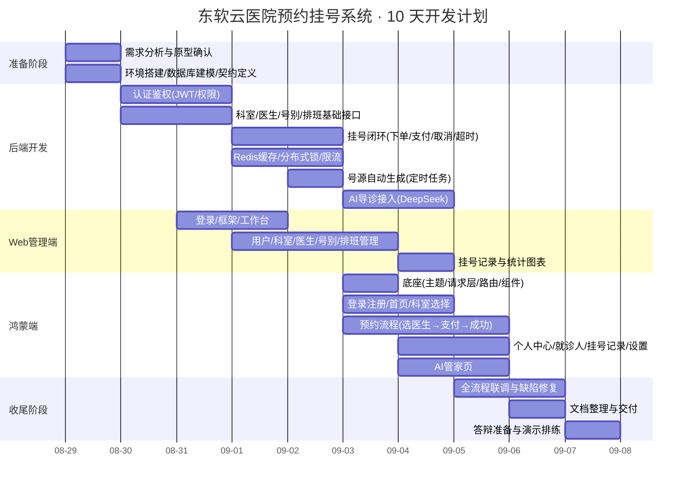

# 项目开发计划

> 版本：v1.0（交付版） ｜ 更新日期：2026-09-05
> 项目周期：10 天（2026-08-29 \~ 2026-09-07），4 人团队

***

## 1. 团队分工

| 成员          | 角色                     | 主要职责                                        |
| ----------- | ---------------------- | ------------------------------------------- |
| A（组长）       | 需求 / 契约 / 测试 / 文档 / 整合 | 需求基线、接口契约、数据库设计、每日分工与风险跟踪、代码整合、鸿蒙底座框架、测试与验收 |
| B 后端工程师     | 后端 + 鸿蒙入口模块            | 认证鉴权、Redis（缓存/锁/限流/黑名单）、就诊人模块；鸿蒙首页与预约入口页    |
| C Web 前端工程师 | 后端挂号闭环 + 鸿蒙预约模块        | 号源查询、下单/支付/取消/超时、联调；鸿蒙选医生→收银台→支付成功全流程       |
| D 鸿蒙端工程师    | Web 管理端 + 鸿蒙个人中心/AI    | 管理端 7 个页面、主题与表格统一；鸿蒙我的/挂号记录/AI 管家页          |

## 2. 里程碑甘特图

## 3. 各阶段交付物

| 阶段     | 时间       | 交付物                                        |
| ------ | -------- | ------------------------------------------ |
| 准备     | 第 1 天    | 需求规格、数据库建表脚本、接口契约、每日分工表                    |
| 后端+管理端 | 第 2–5 天  | 可运行的 REST 服务（Knife4j 文档）、Web 后台全部页面、演示种子数据 |
| 鸿蒙端    | 第 6–8 天  | 15 个页面的 App，挂号全流程在模拟器跑通，AI 导诊对话可用          |
| 收尾     | 第 9–10 天 | 测试报告、交付文档包、答辩 PPT、固定演示脚本                   |

## 4. 验收测试清单

| 编号 | 场景 | 预期结果 |
| --- | --- | --- |
| T01 | 用已注册手机号重复注册 | 拒绝注册并提示"手机号已注册"（409001）；密码密文存储不回传 |
| T02 | 未登录访问下单/就诊人/AI | 请求被拦截返回 401，App 清除本地登录态并跳转登录页 |
| T03 | 一个账号绑定多个就诊人 | 可新增本人/父母/子女等多位就诊人；同账号下手机号重复被拒绝（409002）；列表仅显示本人数据 |
| T04 | 号源筛选 | 切换日期、科室、号别（普通/专家/主任医师）后，只显示匹配且有余号的时段；约满按钮灰显不可点 |
| T05 | 正常预约支付 | 选就诊人提交后生成待支付订单、号源余号减 1；收银台支付后订单变已支付，挂号记录可见 |
| T06 | 并发抢最后一个号 | 两个请求同时下单仅一单成功，余号为 0 且不为负（分布式锁 + 乐观锁） |
| T07 | 重复提交/重复支付 | 同一 idempotencyKey 重试只生成一笔订单；对已支付订单重复调支付接口状态与金额不变（幂等） |
| T08 | 取消与超时 | 待支付/已支付订单均可取消（已支付=退号），取消后余号回补且只回补一次；待支付订单 15 分钟未付被定时任务自动取消 |
| T09 | 后台逻辑删除 | 删除科室/医生/用户后列表默认不可见、数据库记录保留；被排班或订单引用时拒绝删除并提示先停用（409005） |
| T10 | 大 ID 全链路 | 新建的就诊人与号源生成器产生的号源均为 19 位雪花 ID，App 端新建就诊人→下单→支付全流程正常（ID 字符串传输，无精度丢失） |
| T11 | 挂号限流 | 同一用户 1 分钟内下单超过 5 次，返回"操作过于频繁，请 1 分钟后再试" |
| T12 | AI 导诊 | AI 能回答症状咨询、推荐科室；未配置 API Key 时有明确提示；AI 不会绕过患者确认直接下单扣费 |
| T13 | 管理端工作台 | 近 7 日挂号趋势、科室预约排行统计数据与订单实际数据一致 |

## 5. 交付前检查

- [ ] 空库执行 `01_schema.sql` + `02_demo_seed.sql` 可一次性初始化；后端启动后号源自动滚动生成至未来 14 天
- [ ] 三端（后端 / Web 后台 / 鸿蒙 App）按 README 步骤可独立启动；`DEEPSEEK_API_KEY` 走环境变量，仓库无真实密钥
- [ ] T01–T13 全部走通，记录测试日期、结果与缺陷修复情况
- [ ] 准备答辩演示数据：2 个患者账号、3 位以上医生、多科室多号别、未来几天有余号的时段，保证现场可复现完整挂号闭环

## 6. 风险管理（实际执行中遇到的）

| 风险           | 应对                                         |
| ------------ | ------------------------------------------ |
| 四人并行改同一工程冲突  | 鸿蒙端先花半天做"底座"（主题令牌/请求层/类型/路由），成员只在各自页面文件内开发 |
| 合并分支误选旧代码丢功能 | 用 `git diff` 对比合并结果与源分支逐文件核查（实际发生并修复过）     |
| 雪花 ID 前端精度丢失 | 后端 ID 字符串化 + 前端全链路 string 传递（实际踩坑，见测试报告）   |
| 开发机内存不足构建失败  | 构建时关闭后端进程，调大虚拟内存                           |

