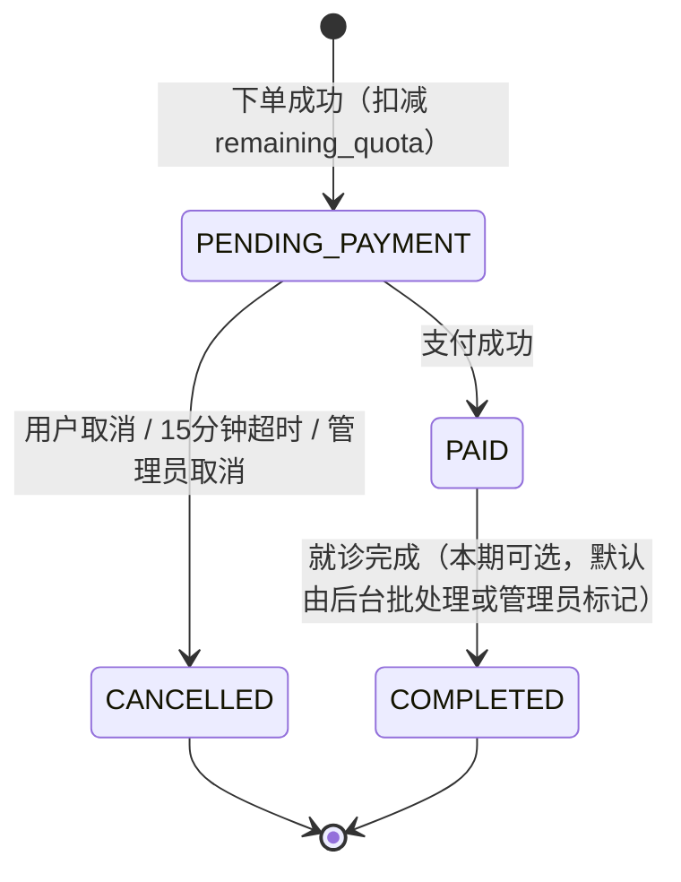
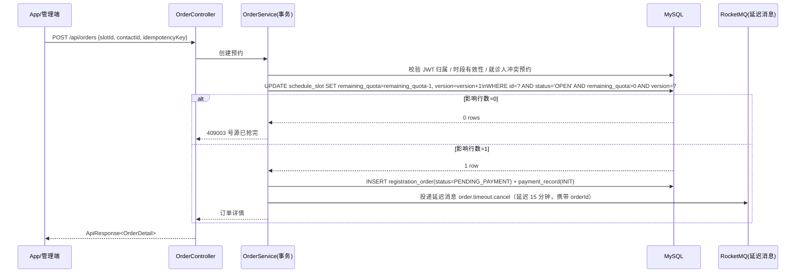
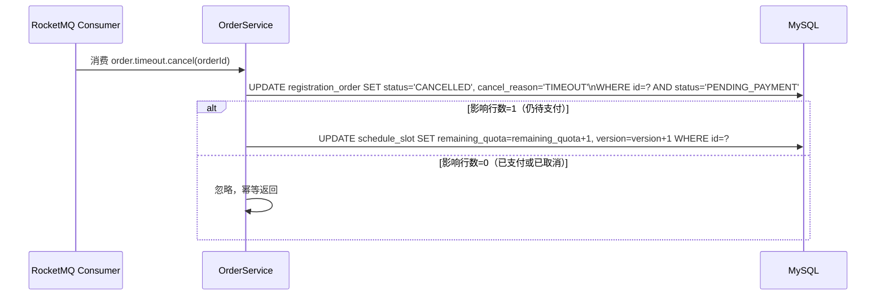

# 挂号流程与状态机

> 负责人：成员 A（组长·流程与契约） | 日期：2026-08-31
> 依据：`docs/02-软件需求规格说明书.md` §3 订单状态机、`docs/03-技术方案与数据设计.md` §3 预约并发方案、`docs/05-数据库设计说明.md` §5 预约事务与库存规则

本篇是对已有状态机结论的流程级拆解，供 B（科室/号源）、C（挂号接口）、D（管理端）在 ⑤⑥⑧ 开发时对齐边界，避免出现"谁在什么状态下才能改库存/改状态"的歧义。

## 1. 订单状态机

**唯一持有库存的状态**：只有 `PENDING_PAYMENT` 表示"已占用一个号源但未确认"。进入 `PAID` 后库存不再变化；离开 `PENDING_PAYMENT`（无论是支付成功还是取消/超时）都必须伴随一次且仅一次的库存动作（扣减已发生过，取消/超时需归还）。

## 2. 号源占用时序（下单）

要点：

- 扣减库存必须使用条件更新（见 §3），不得"先查询余量、再决定是否插入订单"，否则并发场景下会超卖（对应验收 T06）。
- `(user_id, idempotency_key)` 唯一约束拦截网络重试：同一幂等键重复提交返回同一笔订单，而不是报错或重复扣库存（对应验收 T07）。
- 延迟消息投递与订单写入应在同一本地事务提交后再发送（先落库、再发消息，或使用事务消息），避免消息先于数据提交触发消费者查不到订单。

## 3. 15 分钟超时取消流程

- 消费者必须幂等：消息重投、订单已被用户手动取消或已支付，都不能二次归还库存。
- 判断"是否归还库存"的唯一依据是"本次取消 SQL 是否真正把状态从 `PENDING_PAYMENT` 改为 `CANCELLED`"（即 UPDATE 影响行数=1），而不是提前查询状态后再决定，避免竞态。

## 4. 用户主动取消 / 管理员取消

- 复用同一个内部方法 `cancelOrder(orderId, reason)`，触发来源分三种：`POST /api/orders/{id}/cancel`（用户）、`POST /api/admin/orders/{id}/cancel`（管理员）、MQ 消费者（超时）。
- 三者的取消 SQL 条件一致：`WHERE id=? AND status='PENDING_PAYMENT'`，影响行数=1 才归还库存、写 `cancel_reason`（`USER`/`ADMIN`/`TIMEOUT`）。
- 已支付订单不允许普通用户取消（需走退款流程，本期不实现，接口直接返回 409004）。

## 5. 支付成功流程（演示用 Mock 支付）

- `POST /api/orders/{id}/pay`：`UPDATE registration_order SET status='PAID', paid_at=NOW() WHERE id=? AND status='PENDING_PAYMENT'`，同时更新 `payment_record.status=SUCCESS`。
- 影响行数=0 时，说明订单已支付或已取消/超时：已支付重复调用应返回幂等成功（不重复处理，不报错），已取消/超时应返回 409004。
- 库存在支付成功时不再变化——扣减动作已在下单时完成。

## 6. 状态迁移合法性矩阵

| 当前状态 \ 目标 | PAID | CANCELLED | COMPLETED |
| --- | --- | --- | --- |
| PENDING_PAYMENT | ✅ 支付成功 | ✅ 用户/超时/管理员取消 | ❌ |
| PAID | ❌（重复支付应幂等返回成功） | ❌（409004，需走退款，本期不支持） | ✅（管理员标记或批处理） |
| CANCELLED | ❌ | ❌（幂等返回成功） | ❌ |
| COMPLETED | ❌ | ❌ | ❌（幂等返回成功） |

所有"❌"分支在契约中统一返回错误码 `409004 订单状态已变化`（见 `docs/07-RESTful接口契约.md`），不暴露具体状态迁移细节，避免前端按状态字符串做脆弱判断。

## 7. 与验收清单的对应关系

| 验收编号（`docs/04-项目计划、测试与验收.md`） | 对应本篇章节 |
| --- | --- |
| T05 正常预约 | §2 号源占用时序 |
| T06 并发抢最后一个号 | §2 条件更新 + §6 矩阵 |
| T07 重复提交/支付 | §2 幂等键 + §5 支付幂等 |
| T08 超时/取消 | §3、§4 |

后端实现（B/C）与前端联调（C 牵头 ⑦）时，如需在本流程之外新增状态迁移，须先更新本文件并同步 `docs/07-RESTful接口契约.md` 的错误码表，不得在代码中"临时加个特判"。
