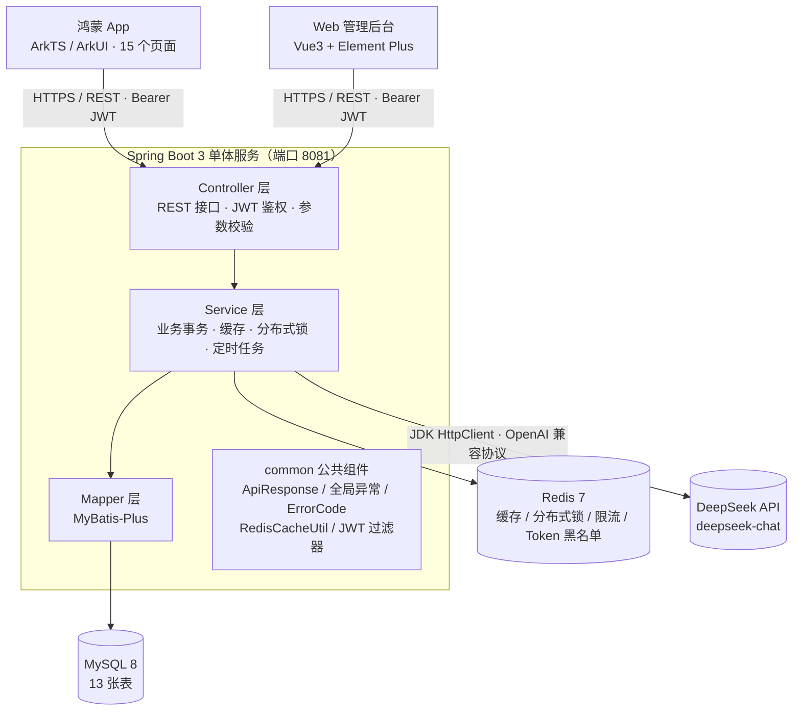
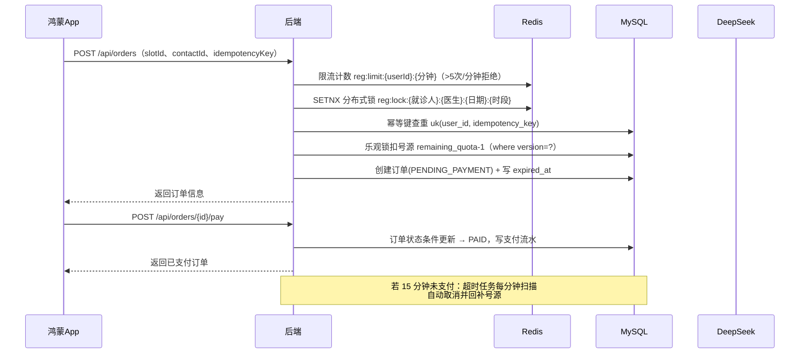
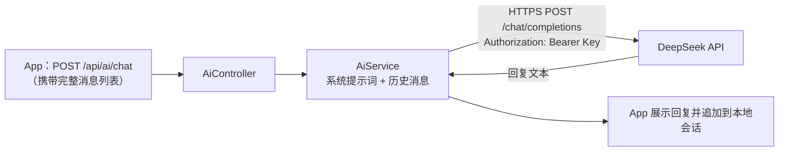

# 系统架构设计

> 版本：v1.0（交付版） ｜ 更新日期：2026-09-05

---

## 1. 总体架构

## 2. 技术选型

| 层 | 技术 | 选型理由 |
| --- | --- | --- |
| 后端框架 | Spring Boot 3 + JDK 17 | 生态成熟，教学主流 |
| 安全 | Spring Security + JJWT | 无状态 JWT 鉴权，患者/管理员双入口 |
| ORM | MyBatis-Plus | 单表 CRUD 免写 SQL，分页/逻辑删除/雪花 ID 内置 |
| 数据库 | MySQL 8.0 | 事务可靠，支持窗口函数/JSON 字段 |
| 缓存 | Redis 7（Lettuce 连接池 + Spring Cache） | 缓存、分布式锁、限流计数、Token 黑名单共用 |
| 接口文档 | Knife4j + OpenAPI 3 注解 | 在线调试，文档与代码同源 |
| AI | DeepSeek（deepseek-chat） | OpenAI 兼容协议，JDK 内置 HttpClient 直连，零额外依赖；Key 在后端 |
| 管理端 | Vue 3 + Vite + Element Plus + Pinia | 后台组件丰富，开发快 |
| 移动端 | HarmonyOS ArkTS / ArkUI | 国产移动生态，声明式 UI |

> 说明：本期未引入消息队列，订单超时取消由 `@Scheduled` 定时任务（每分钟扫描）实现，架构上预留了未来接入 RocketMQ 的位置。

## 3. 后端模块划分

按业务包划分（`com.neusoft.hisspringboot.modules`）：

| 包 | 职责 |
| --- | --- |
| `auth` | 患者/管理员注册登录、JWT 签发与校验、登出黑名单 |
| `user` | 管理端患者账号管理 |
| `department` | 科室树查询与管理（带缓存） |
| `doctor` | 医生档案、号别关联、排班关联 |
| `level` | 挂号级别（号别）管理 |
| `schedule` | 排班规则、号源查询、**号源自动生成器** |
| `contact` | 就诊人 CRUD |
| `order` | 下单、支付、取消、超时任务、统计 |
| `ai` | AI 导诊会话（DeepSeek 调用 + 会话持久化） |
| `common` / `config` / `security` | 统一响应体、全局异常、错误码、Redis 工具、JWT 过滤器、跨域配置 |

分层约定：Controller 只做参数接收与鉴权；业务规则在 Service；Mapper 只访问数据库；跨模块调用通过 Service 注入。

## 4. 核心流程时序（下单 → 支付）

## 5. Redis 应用设计

Key 命名规范：`{业务域}:{用途}:{业务键}`

| Key 模式 | 用途 | 策略 |
| --- | --- | --- |
| `his:cache:{function}:{key}` | 业务缓存（科室树、号源查询等） | Cache-Aside，TTL 5 分钟；数据增删改时主动删除 |
| `his:token:blacklist:{tokenId}` | 登出 Token 黑名单 | TTL = Token 剩余有效期 |
| `reg:lock:{slotId}` | 挂号分布式锁 | SETNX + 过期时间，防同一号源并发超卖 |
| `reg:limit:{userId}:{分钟}` | 挂号限流计数 | 每分钟最多 5 次，INCR + 过期 |

设计要点：

1. **缓存只存 List/普通对象**，不存 MyBatis-Plus 的 Page 分页对象（序列化有坑，实际踩过）。
2. 防超卖是三层防护：Redis 锁（并发请求串行化）→ 号源 `version` 乐观锁（数据库层兜底）→ 幂等键唯一约束（重试/重复点击兜底）。
3. 限流在锁之前，先挡住恶意/误触高频请求。

## 6. 定时任务

| 任务 | 触发 | 职责 |
| --- | --- | --- |
| `ScheduleSlotGeneratorService` | 启动时执行一次 + 每天 00:10（cron） | 把启用中的排班规则展开为未来 14 天号源；唯一键保证幂等；生成后失效号源查询缓存 |
| `OrderTimeoutTask` | 每 60 秒（fixedDelay） | 扫描 `expired_at` 已过且仍为待支付的订单，自动取消并回补号源 |

## 7. AI 导诊调用链

- API Key 只存在于后端配置（环境变量 `DEEPSEEK_API_KEY`），前端不接触。
- 使用 JDK 内置 `java.net.http.HttpClient`，不引入额外 SDK 依赖。
- 服务端无状态：多轮上下文由客户端每次随请求携带；`ai_conversation` / `ai_message` 表当前版本预留未用。

## 8. 安全设计

1. 密码 BCrypt 加密存储，不存明文。
2. 所有接口（除注册登录）走 JWT 过滤器；患者接口与管理员接口双入口，角色不符返回 403。
3. 登出将 Token 加入 Redis 黑名单，立即失效。
4. 挂号接口限流 + 分布式锁，防刷防超卖。
5. 身份证字段预留 AES-GCM 密文 + SHA-256 哈希列，本期不采集。
6. 全局异常处理器兜底，异常堆栈不直接返回前端。

## 9. 前端架构要点（鸿蒙端）

- **分层**：`pages/`（页面）→ `api/`（7 个接口模块）→ `utils/request.ets`（统一请求封装：Token 注入、401 跳登录、统一错误提示）→ `types/index.ets`（全部 DTO 类型）。
- **状态管理**：`store/UserStore.ets` 单例 + Preferences 持久化登录态。
- **设计令牌**：颜色/字号/间距/圆角全部集中在 `resources/base/element/color.json` 与 `float.json`，页面禁止硬编码。
- **大 ID 规约**：所有雪花 ID 按字符串接收与传递，禁止 `Number()` 转换。
