# UI 设计文档（鸿蒙 App）

> 版本：v1.0（交付版） ｜ 更新日期：2026-09-05
> 适用端：HarmonyOS App（ArkTS / ArkUI）
> 原型/截图目录：`docs/images/ui/`（原型设计图与模拟器截图统一放这里，按下表命名后本文图片自动生效）

---

## 1. 设计原则

- **品牌蓝主导**：主色蓝贯穿 AppBar、主按钮、选中态、Tab 高亮，整体简洁可信，符合医疗产品调性。
- **卡片化布局**：内容以白色圆角卡片承载于浅灰页面底之上，信息分区清晰。
- **大字号易读**：面向全年龄段患者，正文 16fp 起步，经过多轮真机走查整体放大字号。
- **令牌统一**：所有颜色、字号、间距、圆角**禁止在页面中硬编码**，统一引用资源文件：
  - 颜色：`entry/src/main/resources/base/element/color.json`
  - 字号/间距/圆角/高度：`entry/src/main/resources/base/element/float.json`
  - 代码侧常量：`utils/theme.ets`

## 2. 颜色规范

| 令牌 | 色值 | 用途 |
| --- | --- | --- |
| `primary` | **#0A66C2** | 品牌主色：AppBar、主按钮、选中态、链接 |
| `primary_light` | #E8F1FC | 主色浅底：选中胶囊底、头像底 |
| `primary_dark` | #084F96 | 主色按压态 |
| `success` | #16A34A | 成功/已支付状态 |
| `warning` | #F59E0B | 待支付/提醒 |
| `danger` | #DB3A2F | 删除/取消/错误 |
| `text_primary` | #1A1A1A | 标题、正文主文字 |
| `text_secondary` | #5B6370 | 次要说明文字 |
| `text_hint` | #9CA3AF | 占位、辅助文字 |
| `bg_page` | #FAFBFC | 页面底色 |
| `bg_card` | #FFFFFF | 卡片底色 |
| `sheet_bg` | #F1F3F5 | 弹窗/底部弹层底色（全 App 统一） |
| `input_bg` | #F5F7FA | 输入框灰底 |
| `divider` / `border` | #EAECF0 / #E5E7EB | 分隔线、边框 |
| `overlay` | #66000000 | 弹窗遮罩（40% 黑） |

## 3. 字号、间距与圆角规范（float.json）

| 类别 | 令牌 | 值 | 用途 |
| --- | --- | --- | --- |
| 字号 | fs_14 ~ fs_32 | 14/15/16/18/20/22/24/26/28/32 fp | 辅助→正文→标题→页面大标题逐级增大 |
| 间距 | sp_4 ~ sp_32 | 4/8/12/16/20/24/32 vp | 4 倍数栅格 |
| 圆角 | radius_sm / md / lg | 8 / 12 / 16 vp | 标签 / 卡片 / 大卡片 |
| 圆角 | radius_pill | 9999 vp | 胶囊按钮、日期选中条 |
| 高度 | app_bar_height | **65 vp** | 顶部蓝色 AppBar |
| 高度 | tab_bar_height | 70 vp | 底部导航栏 |
| 高度 | btn_height_sm/md/lg | 36 / 44 / 52 vp | 按钮三档高度 |
| 阴影 | shadow_card / shadow_modal | 2 / 8 vp | 卡片 / 弹窗 |

## 4. 通用组件

| 组件 | 说明 |
| --- | --- |
| AppBar | 蓝色底、白色标题居中、左侧返回箭头，统一 65vp 高 |
| PrimaryButton | 蓝底白字圆角按钮，加载中禁用防重复点击 |
| GrayTextInput | 灰底圆角输入框，手机号/姓名/搜索框统一样式 |
| FeeTag | 费用标签，金额以"元"展示（后端传分） |
| StatusTag | 订单状态标签（待支付橙 / 已支付绿 / 已取消灰） |
| AvatarIcon | 姓名首字圆形头像，按姓名哈希取色 |
| ConfirmDialog | 居中确认弹窗（删除/取消/退出），#F1F3F5 底，红色危险按钮 |
| EmptyState | 空列表占位 |
| Toast | 自定义大字号提示气泡（"加载中…""网络错误"等），替代系统 toast |

## 5. 页面清单

App 共 15 个页面（`main_pages.json` 注册）：登录、注册、首页（Tab）、预约入口、选择科室、选择医生/号源、选择就诊人、确认预约、收银台、支付成功、AI 管家（Tab）、AI 对话、我的（Tab）、挂号记录、就诊人管理、设置。

## 6. 设计参考图

> 以下为**开发前的 UI 设计参考图**（非真机运行截图），用于确定视觉基调与布局；最终实现以 App 实际运行效果为准。图片源文件位于 `docs/images/`。

**启动与认证**

| 起始页 | 登录 | 注册 |
| --- | --- | --- |
| 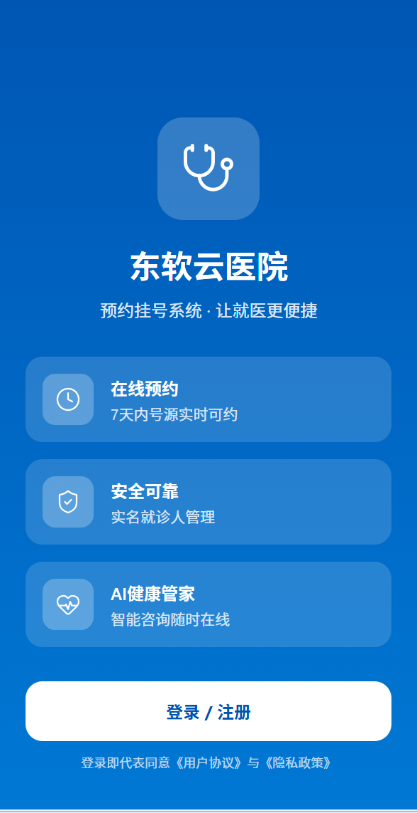 | 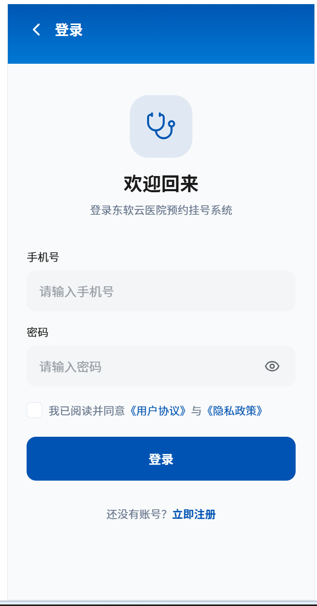 | 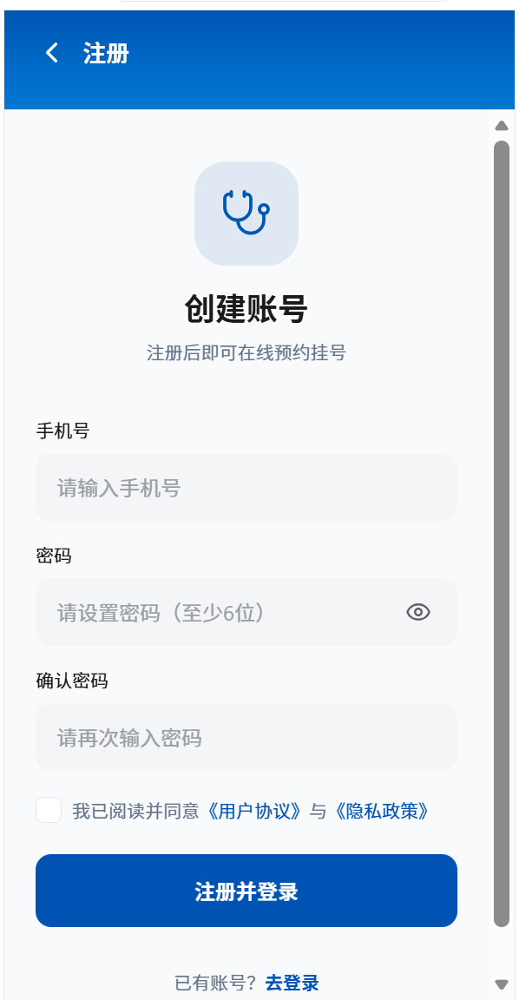 |

**首页与预约**

| 首页 | 预约挂号 | 选择科室 |
| --- | --- | --- |
| 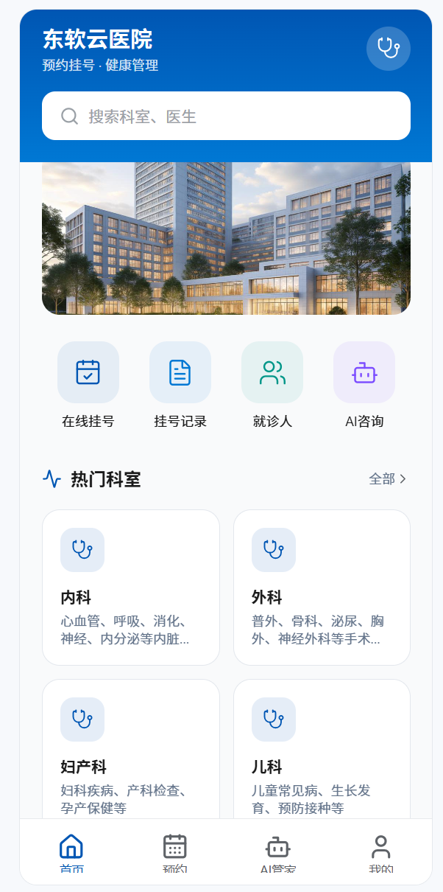 | 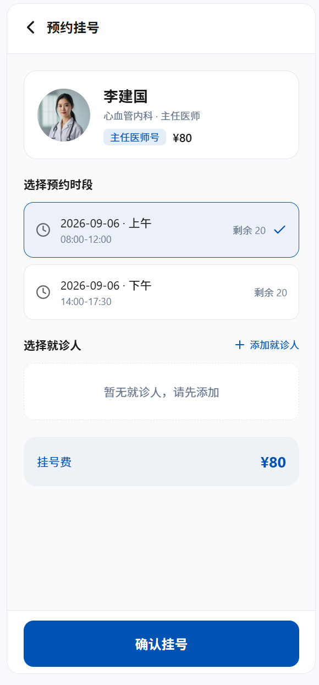 | 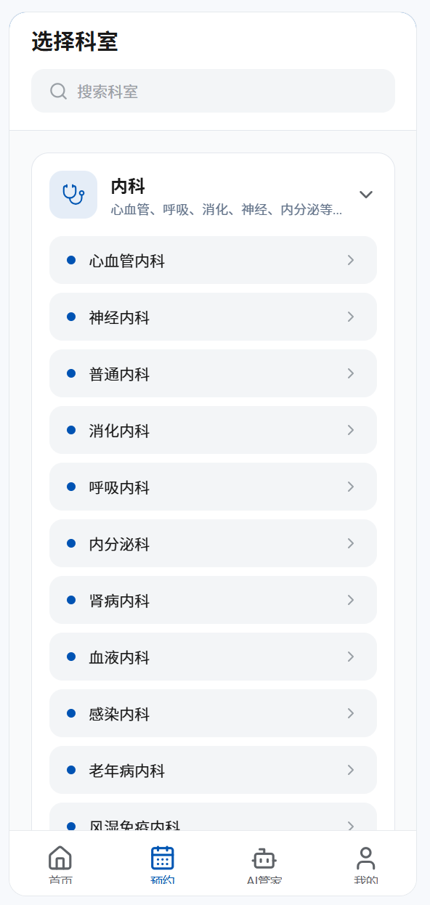 |

**就诊人与挂号记录**

| 就诊人管理 | 添加就诊人 | 挂号记录 |
| --- | --- | --- |
| 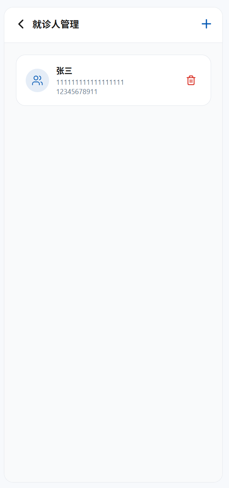 | 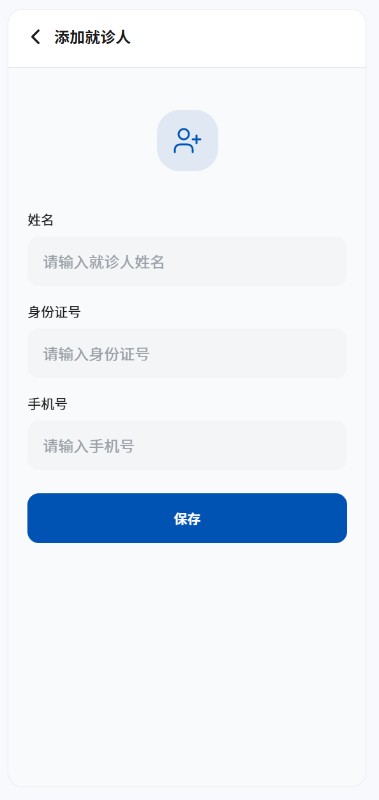 | 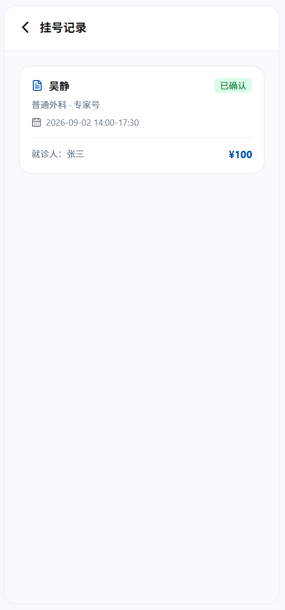 |

**个人中心与 AI 管家**

| 我的 | AI 管家 | 设置 |
| --- | --- | --- |
| 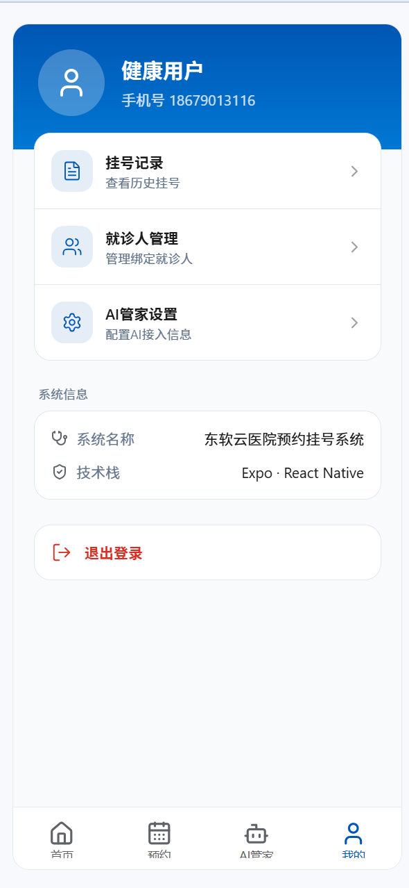 | 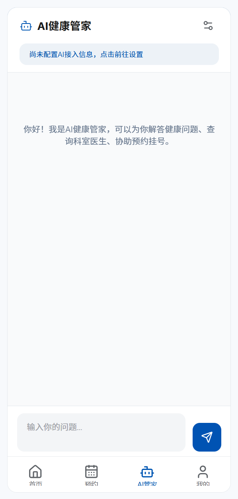 | 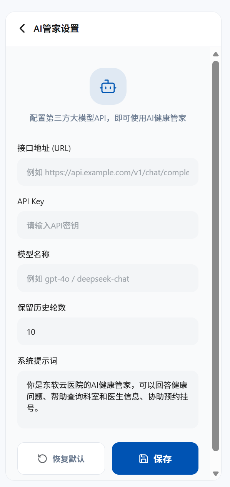 |

**弹窗**

| 退出登录确认弹窗 |
| --- |
| 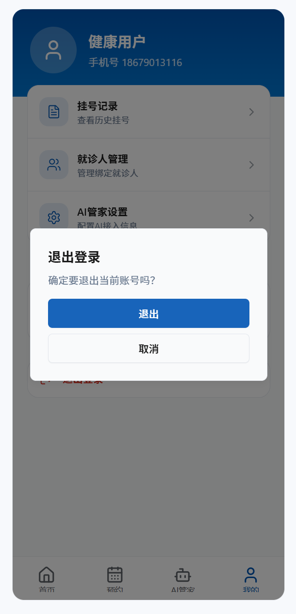 |

## 6. 页面设计要点

- **登录/注册**：蓝色主视觉 + 听诊器 Logo，灰底圆角输入框，蓝色圆角主按钮。
- **首页**：顶部蓝色头部延伸进状态栏（expandSafeArea），Banner 轮播、快捷入口四宫格、热门科室卡片。
- **预约**：科室手风琴展开；7 天日期横条选中态为蓝底白字胶囊；号源按钮灰底不可点 / 蓝底可点。
- **预约闭环**：确认预约 → 收银台 → 支付成功（绿色对勾）三页递进，底部固定金额与操作按钮。
- **挂号记录**：四个状态 Tab（全部/待支付/已支付/已取消），卡片含状态标签与操作按钮。
- **弹窗**：新增就诊人等底部弹层与居中确认弹窗底色统一 #F1F3F5；危险操作按钮为品牌红 #DB3A2F。
- **AI 管家**：对话气泡式布局，输入框固定底部并适配键盘弹出。

## 8. 图标

- 优先使用系统 SymbolGlyph 符号图标（如 `sys.symbol.house`、`sys.symbol.calendar`、`sys.symbol.checkmark_circle_fill`）。
- 品牌标识（听诊器 Logo、Banner）使用 `resources/base/media/` 下的图片资源。
