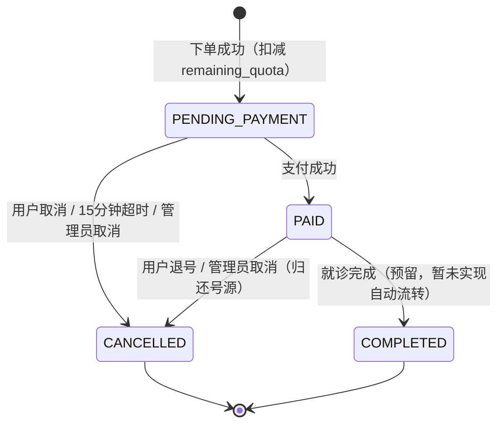
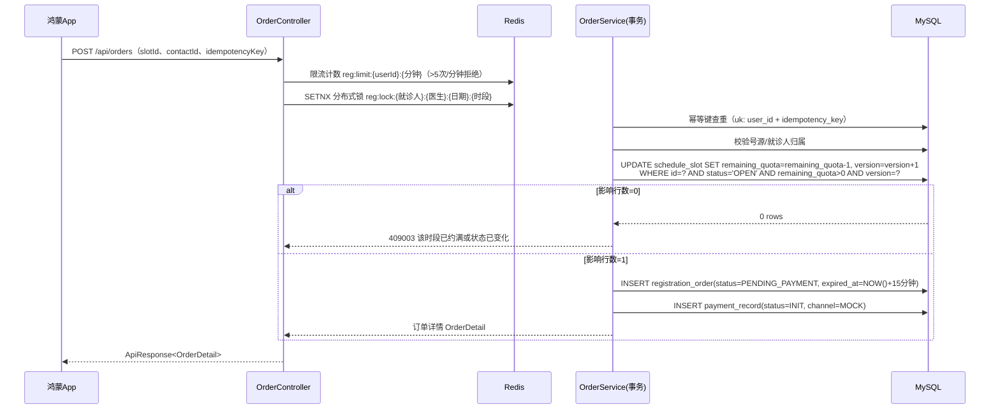
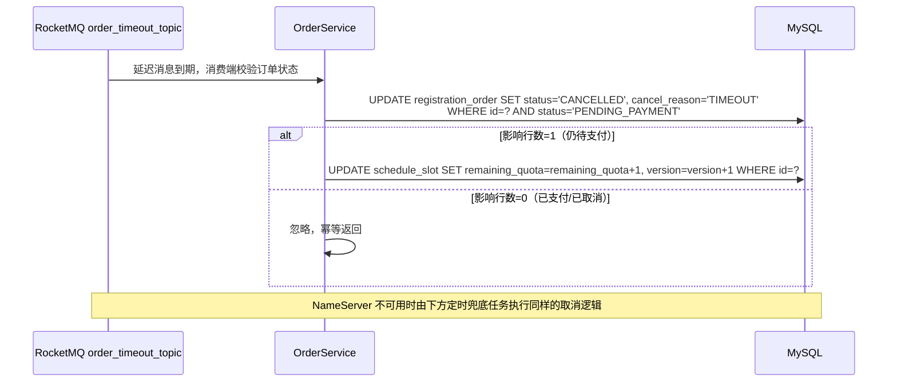

# 挂号流程与订单状态机

> 版本：v1.0（交付版） ｜ 更新日期：2026-09-06
> 配套文档：[02-数据设计文档](../02-数据设计文档.md)、[04-挂号并发控制与防超卖](04-挂号并发控制与防超卖.md)
> 代码位置：`modules/order/service/OrderService.java`、`modules/order/task/OrderTimeoutTask.java`

本篇拆解挂号订单的状态流转边界：谁在什么状态下才能改库存、改状态，避免并发与重试场景下的歧义。

## 1. 订单状态机

**库存动作只发生在两处**：

1. 下单成功：`schedule_slot.remaining_quota - 1`（乐观锁条件更新）
2. 订单离开"有效态"（待支付超时/取消、已支付退号）：`remaining_quota + 1`

归还库存必须**幂等**：以"本次取消 SQL 是否真正把状态改成为 CANCELLED"（UPDATE 影响行数=1）为唯一依据，影响行数=0 说明订单已被其他路径取消，不得二次归还。

## 2. 号源占用时序（下单）

要点：

- 扣减库存必须用条件更新（见 [04-挂号并发控制与防超卖](04-挂号并发控制与防超卖.md)），禁止"先查余量再决定是否插单"，否则并发下超卖。
- `(user_id, idempotency_key)` 唯一约束拦截网络重试与重复点击：同一幂等键重复提交返回同一笔订单，不重复扣库存。
- 待支付订单写入 `expired_at = 下单时间 + 15 分钟`，主通道由 RocketMQ 延迟消息到期触发取消（见《说明文档/06-RocketMQ订单超时与事件说明.md》），定时任务兜底。

## 3. 15 分钟超时取消流程

- 主通道为 RocketMQ 延迟消息到期触发取消；定时任务 `OrderTimeoutTask` 每 5 分钟（fixedDelay=300000）执行一次作为兜底，走 `idx_order_expire_status` 索引扫描，并同时兜底生成 5 分钟未支付提醒。
- 取消动作复用统一内部方法，与用户/管理员取消完全同路径，保证库存归还逻辑只有一份。

## 4. 用户取消 / 管理员取消 / 退号

三个触发入口共用同一个取消方法 `cancelOrder(orderId, reason)`：

| 入口 | 接口 | cancel_reason |
| --- | --- | --- |
| 患者主动取消 | `POST /api/orders/{id}/cancel` | `USER` |
| 管理员取消 | `PUT /api/admin/orders/{id}/cancel` | `ADMIN` |
| 超时自动取消 | 定时任务 | `TIMEOUT` |

- **待支付订单**：取消即释放号源。
- **已支付订单**：当前版本同样允许取消（业务上等同"退号"），取消后号源回补；支付流水保留不删。模拟支付环境不产生真实退款流水，未来接入真实支付渠道时在此分支追加退款调用。
- **已取消/已完成**：再调取消返回 `409004`（前端幂等处理）。

## 5. 支付成功流程（模拟支付）

- `POST /api/orders/{id}/pay`：条件更新 `UPDATE registration_order SET status='PAID', paid_at=NOW() WHERE id=? AND status='PENDING_PAYMENT'`，同时写 `payment_record.status=SUCCESS`（channel=MOCK，trade_no 为应用生成的模拟流水号）。
- 影响行数=0 时：已支付的重复调用幂等返回成功；已取消/超时返回 `409004`。
- 库存在支付时不再变化——扣减在下单时已完成。
- 前端流程：确认预约页下单 → 跳转收银台页（PayPage）展示订单号与金额 → 支付成功跳转支付成功页。

## 6. 状态迁移合法性矩阵

| 当前状态 \ 目标 | PAID | CANCELLED | COMPLETED |
| --- | --- | --- | --- |
| PENDING_PAYMENT | ✅ 支付成功 | ✅ 用户/超时/管理员取消 | ❌ |
| PAID | ❌（重复支付幂等返回成功） | ✅ 用户退号/管理员取消，归还号源 | ✅（预留，暂未实现） |
| CANCELLED | ❌ | ❌（幂等） | ❌ |
| COMPLETED | ❌ | ❌ | ❌（幂等） |

所有"❌"分支统一返回错误码 `409004 订单状态已变化，操作不可执行`，不向前端暴露内部状态细节。

## 7. 与验收清单的对应关系

| 验收编号（[05-项目开发计划](../05-项目开发计划.md) §4） | 对应本篇章节 |
| --- | --- |
| T05 正常预约支付 | §2 下单时序、§5 支付 |
| T06 并发抢最后一个号 | §2 条件更新 + §6 矩阵 |
| T07 重复提交/支付 | §2 幂等键 + §5 支付幂等 |
| T08 取消与超时 | §3、§4 |
