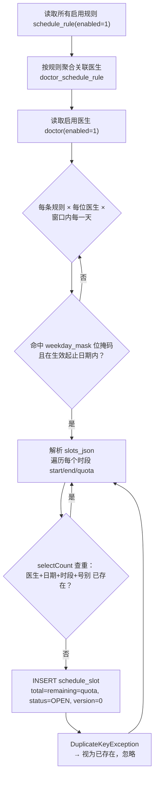

# 号源自动生成说明（排班规则展开）

> 版本：v1.0 ｜ 更新日期：2026-09-06
> 代码位置：`modules/schedule/service/ScheduleSlotGeneratorService.java`

## 1. 解决什么问题

排班规则（`schedule_rule`）是"周一三五上午，08:00-08:30 放 10 个号"这样的**周期模板**，患者无法直接预约模板。系统需要把规则展开成未来每一天、每个时段的**具体号源**（`schedule_slot`）——这就是号源生成器的职责，保证患者端始终有未来 14 天的号可挂，无需管理员逐日录入。

## 2. 三个触发时机

| 触发方式 | 说明 |
| --- | --- |
| 应用启动时 | 类实现 `ApplicationRunner`，后端启动即执行一次，防止种子号源过期后无号 |
| 每天 00:10 定时 | `@Scheduled(cron = "0 10 0 * * ?")`，滚动把窗口向前推进 |
| 管理端保存排班规则 | 新增/编辑规则后主动调用 `generateNextDays()`，立即生效 |

生成窗口固定为 **[今天, 今天+13 天]，共 14 天**（`GENERATE_DAYS = 14`）。

## 3. 展开流程

### 关键字段来源

| 号源字段 | 取值 |
| --- | --- |
| `schedule_rule_id` | 当前规则 ID |
| `doctor_id` / `department_id` | 医生 ID / **医生所属科室**（号源挂在医生所在科室下） |
| `level_id` | **规则上的号别**（不是医生主号别） |
| `visit_date` / `start_time` / `end_time` | 窗口内命中日期 + slots_json 时段 |
| `total_quota` / `remaining_quota` | 都取 slots_json 的 `quota` |
| `status` / `version` | `OPEN` / `0` |

### weekday_mask 位掩码

bit0~bit6 依次对应**周一~周日**（`date.getDayOfWeek().getValue() - 1`）。例：周一、周三、周五 = 1+4+16 = **21**。

## 4. 幂等保证（双保险）

1. 插入前 `selectCount` 按 `(doctor_id, visit_date, start_time, end_time, level_id)` 查重；
2. 插入时依赖数据库唯一键 `uk_slot_doctor_date_time_level`，并发场景下 `DuplicateKeyException` 被捕获并忽略。

因此生成器可以**安全地重复执行**，不会产生重复号源。

## 5. 与缓存的联动

号源查询接口走 Redis 缓存（key 前缀 `his:cache:slotQuery:`，Cache-Aside，5 分钟 TTL）。本次生成**有新插入**时，执行 `deleteByPrefix("his:cache:slotQuery:")` 清掉全部号源查询缓存，让患者端下次查询回源看到新号；无新增则不清缓存。

## 6. 异常容错

- 规则的 `slots_json` 解析失败：只跳过该条规则并打印 warn 日志，不影响其他规则；
- 规则关联的医生不存在或已停用：跳过；
- `quota <= 0` 的时段：跳过。

## 7. 未来扩展

- 管理员**临时加号/停诊**：可直接 INSERT 一条 `schedule_rule_id = NULL` 的号源（加号），或把号源 `status` 改为 `CLOSED`（停诊），表结构已预留；
- 生成窗口天数做成配置项；
- 生成后通过消息队列通知（当前未引入 MQ）。
