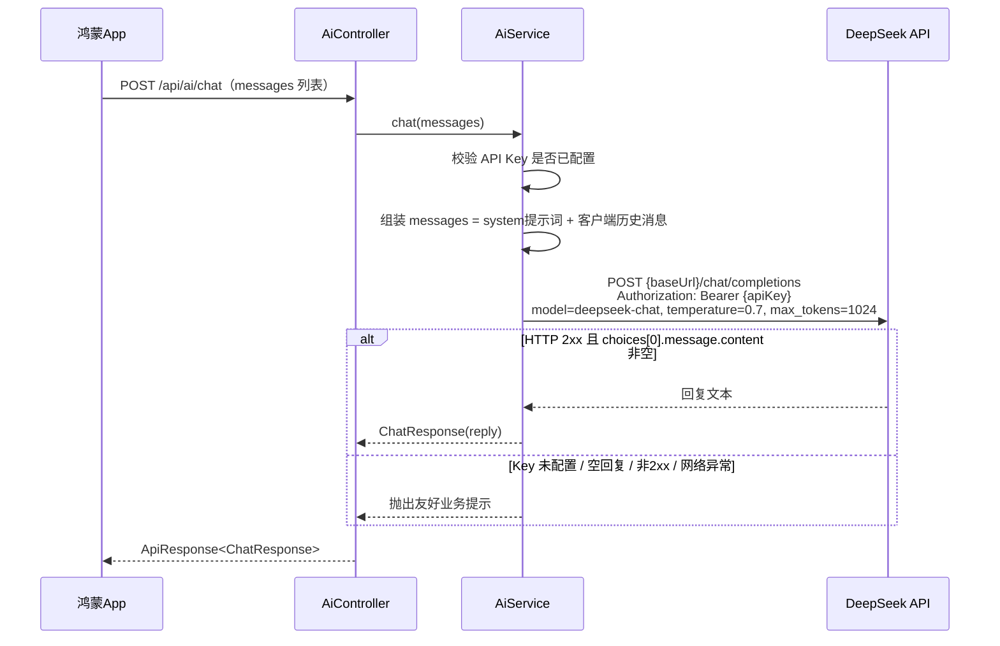

# AI 导诊接入说明（DeepSeek）

> 版本：v1.0 ｜ 更新日期：2026-09-06
> 代码位置：`modules/ai/`（`controller/AiController.java`、`service/AiService.java`、`dto/`）

## 1. 方案概述

AI 导诊助手"东软云医院 AI 管家"接入 **DeepSeek 大模型**（`deepseek-chat`），为患者提供：症状咨询、根据症状推荐就诊科室、挂号与就诊流程解答、引导完成在线预约。

技术上采用 DeepSeek 的 **OpenAI 兼容协议**（`POST /chat/completions`），使用 **JDK 17 内置的 `java.net.http.HttpClient`** 直接调用，不引入任何第三方 AI SDK，零额外依赖。

## 2. 接口形态

- `POST /api/ai/chat`（需登录，未登录 401）
- **服务端无状态**：多轮对话上下文由**客户端每次携带完整消息列表**，服务端不保存会话：

```json
// 请求
{
  "messages": [
    { "role": "user", "content": "头疼应该挂什么科？" },
    { "role": "assistant", "content": "头痛建议先挂神经内科……" },
    { "role": "user", "content": "明天有号吗？" }
  ]
}
// 响应
{ "code": 200, "message": "操作成功", "data": { "reply": "您可以在预约挂号页选择神经内科……" } }
```

> `ai_conversation` / `ai_message` 两张表当前版本**预留未用**（服务端不落库），未来做"历史会话"功能时启用。

## 3. 调用链



## 4. 配置项（application.yml）

```yaml
app:
  ai:
    deepseek:
      api-key: ${DEEPSEEK_API_KEY:}        # 优先读环境变量；为空时接口提示"AI 服务未配置 API Key"
      base-url: https://api.deepseek.com
      model: deepseek-chat
```

- API Key 通过环境变量 `DEEPSEEK_API_KEY` 注入（IDEA 运行配置或系统环境变量），**不写进代码、不提交仓库**；
- 未配置 Key 时其他功能完全不受影响，仅 AI 接口返回明确提示。

## 5. 系统提示词（人设与边界）

```text
你是"东软云医院"的 AI 导诊助手。你可以根据用户的症状描述推荐合适的就诊科室，
解答挂号、就诊流程、科室/医生信息等问题，并引导用户完成在线预约挂号。
请用简洁、专业、友好的中文回答，重点直接给出建议，尽量控制在 200 字以内；
如遇胸痛、大出血、呼吸困难等急危重症，请提醒用户立即就医或拨打急救电话。
```

调用参数：`temperature = 0.7`（平衡稳定与灵活）、`max_tokens = 1024`、`stream = false`（非流式）；连接超时 10 秒、读取超时 60 秒。

## 6. 错误处理

| 情况 | 用户看到的提示 |
| --- | --- |
| 未配置 API Key | 「AI 服务未配置 API Key，请在后端配置后重试」 |
| DeepSeek 返回空内容 | 「AI 返回内容为空，请重试」 |
| DeepSeek 返回非 2xx | 「AI 服务异常：{对方返回的 message}」 |
| 网络超时/异常 | 「AI 服务暂时不可用，请稍后重试」（异常详情记日志，不抛给前端） |

## 7. 安全与边界

1. **Key 不出后端**：前端只调本系统接口，永远接触不到 DeepSeek Key；
2. **必须登录**：接口走统一 JWT 过滤器，未登录 401；
3. **能力边界**：当前 AI 只做文本咨询——**不能查询实时号源、不能代替患者下单/支付**，涉及预约动作一律引导患者在页面上自行确认；
4. 暂未使用 Function Calling（工具调用），AI 不直接访问业务数据库。

## 8. 未来扩展方向

- **会话持久化**：启用 `ai_conversation` / `ai_message` 表，支持"历史对话"列表与多设备同步；
- **实时号源查询**：引入 Function Calling，让 AI 调用号源查询接口回答"明天某科室有没有号"；
- **AI 辅助下单**：AI 收集患者意图后生成预约草稿，**由患者最终确认支付**（不自动扣费）；
- 流式输出（SSE）改善长回复等待体验。
